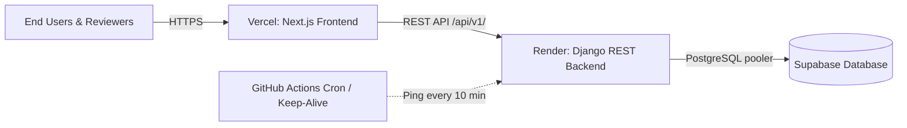

# UNBUmi Detector — Master Production Hosting & 24/7 Keep-Alive Guide

**Product:** UNBUmi Detector (UNLEFT LandGuard)  
**Hackathon Track:** P3 — Catch Fraud & Double-Selling  
**Repository:** [https://github.com/Eashanoppo/unbhumi](https://github.com/Eashanoppo/unbhumi)  

This walkthrough details the exact step-by-step procedure to deploy the Django backend on **Render**, host the Next.js frontend on **Vercel**, configure **Supabase PostgreSQL**, and keep the free-tier backend continuously alive 24/7 without cold-start delays.

---

## Architecture Overview



---

## Phase 1: Deploy Django Backend to Render

We have provided a turnkey `render.yaml` Blueprint file and `backend/build.sh` script in the repository.

### Option A: Render Blueprint Deployment (Automated & Recommended)
1. Sign in to [Render.com](https://render.com/).
2. On your Render dashboard, click **"New +"** and choose **"Blueprint"**.
3. Connect your GitHub account and select the **`Eashanoppo/unbhumi`** repository.
4. Render will automatically detect `render.yaml` and configure:
   - **Service Name:** `unbhumi-backend`
   - **Runtime:** Python 3.11.9
   - **Root Directory:** `backend`
   - **Build Command:** `./build.sh` (installs dependencies, runs `collectstatic` with WhiteNoise, executes migrations, and seeds the 8 demo cases)
   - **Start Command:** `gunicorn config.wsgi:application --bind 0.0.0.0:$PORT`
   - **Health Check Path:** `/api/v1/health/`
5. Click **Apply**.
6. **Provide Secrets (Environment Tab):**
   - In the Render dashboard, go to `unbhumi-backend` -> **Environment** tab.
   - If using **Supabase PostgreSQL**, paste your connection string into `DATABASE_URL`:
     ```text
     postgresql://postgres:[YOUR-PASSWORD]@[YOUR-SUPABASE-HOST]:6543/postgres?pgbouncer=true
     ```
     *(If left blank, the backend automatically uses SQLite for instant demo deployment!)*
   - Ensure `CORS_ALLOW_ALL_ORIGINS` is set to `True` (or set `CORS_ALLOWED_ORIGINS` to your Vercel URL once Phase 2 is completed).
7. Trigger a manual deploy if needed. Once finished, copy your public backend URL (e.g. `https://unbhumi-backend.onrender.com`).
8. Verify in your browser by opening `https://unbhumi-backend.onrender.com/api/v1/health/`. You should see:
   ```json
   {
     "status": "healthy",
     "database": "connected",
     "service": "UNBUmi Detector API",
     "track": "P3 — Catch Fraud & Double-Selling",
     "demo_mode": true
   }
   ```

---

## Phase 2: Deploy Next.js Frontend to Vercel

Vercel provides zero-configuration hosting for Next.js 16.

1. Sign in to [Vercel.com](https://vercel.com/) with your GitHub account.
2. Click **"Add New Project"**.
3. Import the **`Eashanoppo/unbhumi`** repository.
4. **CRITICAL SETTING — Configure Root Directory:**
   - In the project setup card, look for **Root Directory**.
   - Click **Edit** and select **`frontend`**.
   - The Framework Preset will automatically identify **Next.js**.
5. **Configure Environment Variables:**
   - Click the **Environment Variables** accordion and add:
     - **Name:** `NEXT_PUBLIC_API_URL`
     - **Value:** `https://unbhumi-backend.onrender.com/api/v1` *(replace with your actual Render URL from Phase 1)*
6. Click **Deploy**.
7. Vercel will build the frontend using Turbopack and deploy to a URL like `https://unbhumi.vercel.app`.

---

## Phase 3: Synchronize CORS & Verify End-to-End

1. Once Vercel assigns your live domain (e.g. `https://unbhumi.vercel.app`):
2. In your Render Dashboard -> **Environment**, optionally add your Vercel domain to `CORS_ALLOWED_ORIGINS` and `CSRF_TRUSTED_ORIGINS`:
   ```text
   CORS_ALLOWED_ORIGINS=https://unbhumi.vercel.app,http://localhost:3000
   CSRF_TRUSTED_ORIGINS=https://unbhumi.vercel.app,https://*.onrender.com
   ```
3. Open your Vercel URL in your browser:
   - Verify that all 8 seeded cases appear on `/dashboard`.
   - Test changing demo roles in `/settings`.
   - Inspect Case `UB-2026-1002` to see the live NetworkX ownership graph.
   - Test generating and printing reports on `/reports`.

---

## Phase 4: Keeping the Server Live 24/7 (Preventing Sleep / Cold Starts)

Render free-tier web services automatically spin down after 15 minutes of inactivity, causing a 40–50 second delay on the next visit. We have set up **three complementary mechanisms** to guarantee zero downtime:

### Strategy 1: Automated GitHub Actions Keep-Alive Cron (Built-in & Free)
We have added [`.github/workflows/keep_alive.yml`](file:///.github/workflows/keep_alive.yml) to the repository. It runs an automated HTTP health ping every 10 minutes from GitHub cloud runners:

1. Open your GitHub repository: `https://github.com/Eashanoppo/unbhumi`.
2. Go to **Settings** -> **Secrets and variables** -> **Actions**.
3. Click **"New repository secret"**:
   - **Name:** `BACKEND_API_URL`
   - **Value:** `https://unbhumi-backend.onrender.com` *(your Render URL)*
4. Click **Add secret**.
5. Go to the **Actions** tab on GitHub, click **"Keep UNBUmi Backend Alive"**, and click **"Run workflow"** to verify immediately.
6. The workflow will now ping `/api/v1/health/` every 10 minutes forever, keeping your Render container warm 24 hours a day!

### Strategy 2: Client-Side Heartbeat in Frontend (Built-in)
- `frontend/components/Navbar.tsx` now contains an automatic background heartbeat (`api.getHealth()`) that pings the backend every 8 minutes whenever any user has the web application open in their browser.

### Strategy 3: External Free Uptime Monitor (Optional Backup)
You can also register a free ping on any public uptime monitor:
1. Visit [cron-job.org](https://cron-job.org/) or [UptimeRobot.com](https://uptimerobot.com/).
2. Create a free HTTP monitor:
   - **URL:** `https://unbhumi-backend.onrender.com/api/v1/health/`
   - **Interval:** Every 10 minutes
   - **Method:** `GET`

---

## Quick Reference Summary

| Service | Host | Configuration Key | Destination Value |
|---|---|---|---|
| **Frontend** | Vercel | Root Directory | `frontend` |
| **Frontend** | Vercel | `NEXT_PUBLIC_API_URL` | `https://unbhumi-backend.onrender.com/api/v1` |
| **Backend** | Render | Blueprint Path | `./render.yaml` (Root) |
| **Backend** | Render | Health Check | `/api/v1/health/` |
| **Backend** | Render | `DATABASE_URL` (Optional) | Supabase PostgreSQL URI |
| **24/7 Keep-Alive** | GitHub Actions | Secret `BACKEND_API_URL` | `https://unbhumi-backend.onrender.com` |
