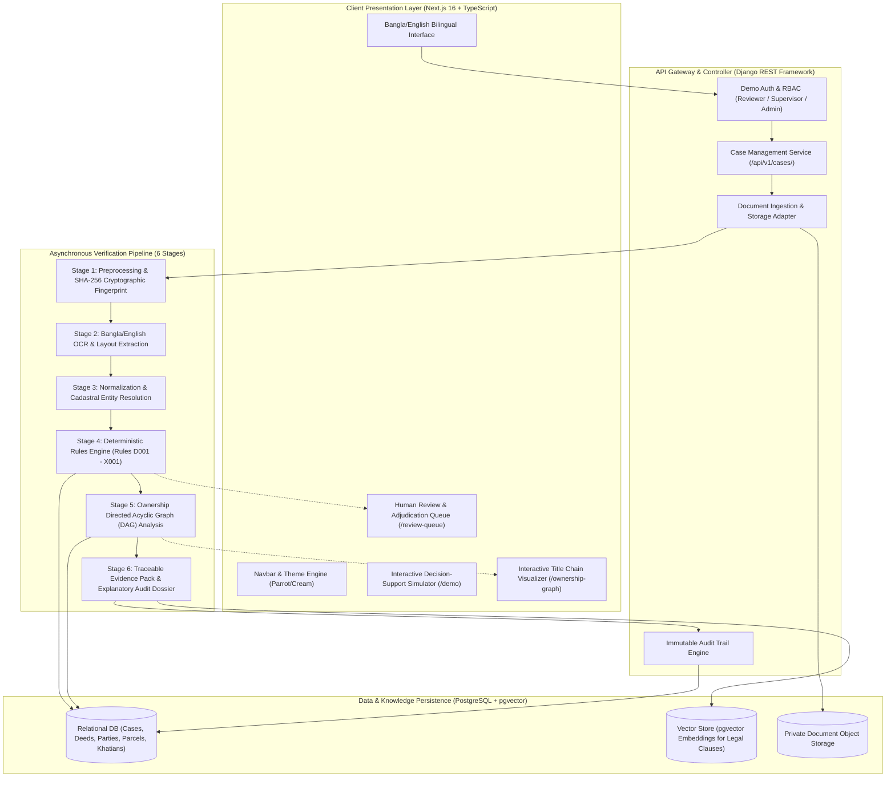

Viewed documentation.md:1-100
Searched for "## "
Searched for "^##\s+"
Viewed documentation.md:265-375
Viewed documentation.md:376-475

# UNLEFT LandGuard (UNBHUMI Detector)
## System Architecture, Technology Stack & Core Feature Guide
*Derived from and aligned with [`documentation.md`](file:///d:/UnBhumi/Doc/documentation.md)*

---

### Executive Overview

**UNLEFT LandGuard** is a multimodal, evidence-first decision-support platform engineered for Bangladesh's **LandTech Track P3: Catch Fraud & Double-Selling** (supported by **P2: Deed & Ownership Verification**). It cross-checks registered deeds, historical baya deeds, survey khatians, mutation records, cadastral mouza maps, and land tax receipts to detect fraudulent transfers, duplicate plot sales, and forged documents before registration or mortgage approval.

---

### 1. System Architecture

The system follows an asynchronous, decoupled, multi-tier architecture with human-in-the-loop verification gates:

#### Pipeline Data Flow
1. **Ingestion & Fingerprinting:** Uploaded PDF/TIFF/JPEG scans are assigned an immutable UUID, fingerprinted via SHA-256, and cross-referenced with the enrolled document registry.
2. **Layout-Aware Extraction:** Bangla OCR extracts deed schedules, non-judicial stamp numbers, party names, dag numbers, khatian serials, and areas with coordinate-level confidence metrics.
3. **Normalization & Canonicalization:** Numbers are mapped between Bengali and Arabic numerals (`১২৩` ↔ `123`), land units are converted to decimal acres (`শতক/একর`), and phonetic names are normalized.
4. **Deterministic Evaluation:** 15 rules check for parcel over-allocation, broken title chains, and AC Land status contradictions.
5. **Graph Traversal:** The transaction graph models land parcel transitions as directed edges (`Person` → `Deed` → `Person`) to identify competing branches, temporal paradoxes, or cycles.
6. **Adjudication & Reporting:** Produces an auditable PDF/JSON report with highlighted bounding boxes, raw vs. normalized values, and confidence metrics.

---

### 2. Technology Stack

| Layer | Technology | Version / Specification | Rationale & Responsibility |
|---|---|---|---|
| **Frontend Framework** | [Next.js](file:///d:/UnBhumi/frontend/package.json) | `16.4.2` (Turbopack, App Router) | Fast server-side rendering, responsive layouts, dynamic routing. |
| **Language** | [TypeScript](file:///d:/UnBhumi/frontend/tsconfig.json) | `^5.0` | Strict type safety across document schemas and verification matrices. |
| **Styling & Theme** | [Vanilla CSS & TailwindCSS](file:///d:/UnBhumi/frontend/app/globals.css) | Custom CSS Tokens | Custom Bangladesh LandTech palette (Parrot Green `#15803D` & Warm Cream `#FBF8EE`). |
| **Icons & UI** | [lucide-react](file:///d:/UnBhumi/frontend/package.json) | `^1.16.0` | Clean SVG iconography (no amateur emojis). |
| **Backend API** | [Django REST Framework](file:///d:/UnBhumi/backend/config/urls.py) | Python `3.11+` / DRF `3.15` | Relational workflows, migrations, object-level permissions, and admin dashboard. |
| **Database** | [PostgreSQL](file:///d:/UnBhumi/backend/config/settings.py) | `15+` (Hosted on Supabase) | ACID compliance for deeds, parcels, mutation statuses, and audit events. |
| **Vector Storage** | [pgvector](file:///d:/UnBhumi/backend/apps/documents/models.py) | PostgreSQL Extension | Semantic chunk retrieval for RAG evidence generation and deed clause matching. |
| **Document Storage** | Private Object Storage | Supabase Storage / S3 | Raw scans stored securely; accessed via time-limited signed URLs. |
| **Graph Analysis** | [NetworkX & SQL Traversal](file:///d:/UnBhumi/backend/apps/ownership/models.py) | Python Graph Library | Detects cycles, broken baya chains, and duplicate active transfer edges. |
| **OCR & Vision** | Tesseract Bangla + TrOCR | PyTorch / Python Bindings | Scans non-judicial stamps, handwritten porchas, and deed schedules. |
| **Document Integrity** | SHA-256 Engine | Python `hashlib` | Byte-level tamper detection against the registered document vault. |

---

### 3. Main Features & Capabilities

#### A. 6 Mandatory Core Bangladeshi Land Document Types
Implemented in [`DocumentGenuineViewer.tsx`](file:///d:/UnBhumi/frontend/components/DocumentGenuineViewer.tsx):

| Document Type | Bengali Name | Primary Purpose | Detects Under P2 / P3 |
|---|---|---|---|
| **Registered Deed** | সাফ-কবলা দলিল | Verifies transfer date, deed number, consideration, executant, and schedule. | Forged deeds, multiple registered sales on same dag (P2/P3). |
| **Previous Deeds** | বায়া দলিল | Traces historical sequence of title ownership back to original survey. | Broken chain of title, missing intermediate transfers (P2/P3). |
| **Latest Khatian** | খতিয়ান (RS/BS/CS/SA) | Validates government record of rights, recorded owner, and parcel area. | Discrepancies between deed executant and surveyed owner (P2/P3). |
| **Mutation Khatian** | নামজারি খতিয়ান ও ডিসিআর | Verifies AC Land approval decree, case number, and DCR payment receipt. | Transfers without mutation, rejected/fabricated mutation orders (P3). |
| **Cadastral Mouza Map** | মৌজা নকশা ও প্লট | DLRS vector plot geometry (`scale 16" = 1 mile`) with boundary dimensions. | Plot boundary multi-sales, survey bifurcation anomalies (P3). |
| **Land Tax Dakhila** | ভূমি উন্নয়ন কর দাখিলা | Confirms holding tax payment with mandatory statutory disclaimer. | Inconsistent holding references (Supporting evidence only). |

> [!IMPORTANT]
> **Legal Safeguard:** In adherence to Bangladeshi Land Law, a Tax Dakhila (*ভূমি উন্নয়ন কর দাখিলা*) is treated strictly as *supporting evidence of rent payment* and **never** as stand-alone proof of legal title.

---

#### B. Deterministic Fraud-Signal Rules Engine
Implemented in [`backend/services/rule_engine.py`](file:///d:/UnBhumi/backend/services/rule_engine.py) and [`frontend/lib/demoScenarios.ts`](file:///d:/UnBhumi/frontend/lib/demoScenarios.ts):

- **Rule `D001` (Cryptographic Hash Mismatch):** Detects digital tampering or pixel-level manipulation against enrolled deed records.
- **Rule `D002` (Deed Serial/Date Conflict):** Flags conflicting volume numbers or sub-registry execution dates.
- **Rule `O001` / `O002` (Ownership Chain Gaps):** Flags transactions where seller acquisition date is later than transfer date or missing from prior deeds.
- **Rule `P001` (Exact Parcel Double-Selling):** Flags active, overlapping sales on identical normalized parcel keys within the limitation window.
- **Rule `P002` / `R-03` (Area Deficit Over-Transfer):** Triggers when the cumulative area transferred across linked deeds exceeds the total recorded area in the Khatian.
- **Rule `P004` (Survey Transition Anomaly):** Flags parcels split or re-numbered during survey transitions (e.g., RS Dag 88 bifurcated into BS Dags 142 & 143).
- **Rule `M001` / `R-06` (Mutation Record Contradiction):** Detects rejected or cancelled mutation decrees at the AC Land office.
- **Rule `G001` (Collateral Conflict):** Flags properties pledged to financial institutions with active court injunctions (*Artha Rin Adalat*).
- **Rule `X001` (Low OCR Confidence Gate):** Flags low-confidence smudged numbers for mandatory human review instead of making automatic assumptions.

---

#### C. Traceable Ownership Graph & Chain of Title
Implemented in [`frontend/app/ownership-graph/page.tsx`](file:///d:/UnBhumi/frontend/app/ownership-graph/page.tsx):
- Visualizes buyers, sellers, deeds, mortgages, and survey records as an interactive Directed Acyclic Graph (DAG).
- Highlights clean ownership pathways in green and conflicting transfers in crimson.
- Calculates node centrality to identify high-frequency deed brokers or disputed family lineages.

---

#### D. Human-in-the-Loop (HITL) Adjudication
Implemented in [`frontend/app/review-queue/page.tsx`](file:///d:/UnBhumi/frontend/app/review-queue/page.tsx):
- The platform never makes definitive declarations of "fraud." It flags evidential discrepancies for authorized human reviewers.
- Document Reviewers can inspect original side-by-side scans, edit normalized fields, and assign dispositions:
  - `VERIFIED_CLEAR` (স্বত্ব সামঞ্জস্যপূর্ণ)
  - `EVIDENCE_CONFLICT` (স্বত্ব বিরোধ শনাক্ত)
  - `FURTHER_INQUIRY` (অতিরিক্ত নথির আবেদন)
  - `REJECTED_SUSPECTED_TAMPER` (বাতিল — জালিয়াতির সন্দেহ)

---

### 4. Seeded Demonstration Cases

Available in the Interactive Decision-Support Suite at [`/demo`](file:///d:/UnBhumi/frontend/app/demo/page.tsx):

1. **Clean Baseline** (`UB-2026-1001`): Unbroken baya deed lineage with matching BS Khatian and AC Land mutation.
2. **Classic Double-Sale** (`UB-2026-1002`): Duplicate sale conflict detection on the same parcel.
3. **Case A: Area Deficit Conflict** (`Rule R-03`): 50 decimal parcel where two deeds transfer 30 + 25 = 55 decimals.
4. **Case B: Cryptographic Hash Tampering** (`Rule D001`): SHA-256 byte mismatch against sub-registry vault.
5. **Case C: Historical Survey Transition** (`Rule P004`): RS Dag 88 bifurcated into BS Dags 142 & 143.
6. **Case D: Registration vs. Mutation Mismatch** (`Rule R-06`): Registered deed rejected by AC Land e-mutation.
7. **Case E: Collateral / Bank Injunction** (`Rule G001`): Active civil mortgage lien under *Artha Rin Adalat*.
8. **Case F: Low OCR Confidence Gate** (`Rule X001`): Smudged porcha number triggering human-in-the-loop review.