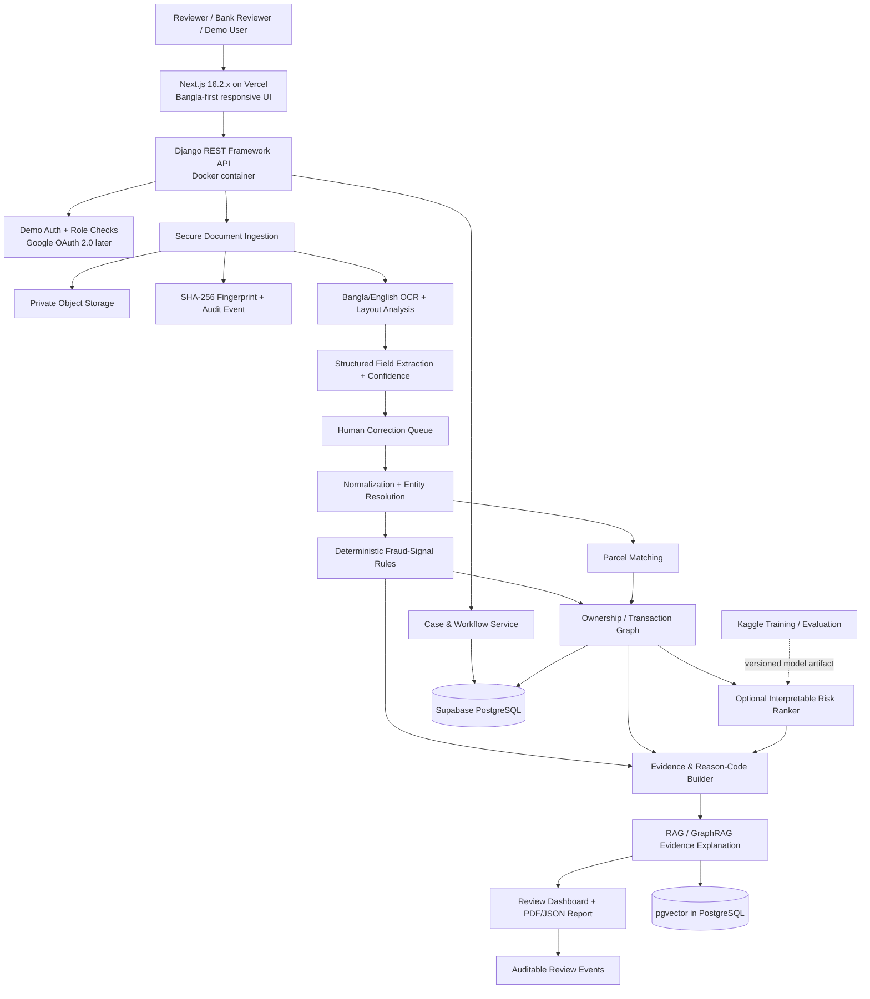

# UNLEFT LandGuard
## Final Merged Project Documentation — Multimodal Land Fraud & Double-Selling Detection for Bangladesh
**Primary track:** P3 — Catch Fraud & Double-Selling  
**Supporting capability:** P2 — Verify Deeds & Ownership  
**Prepared for:** LandTech Innovation Hackathon 2026  
**Status:** Final merged implementation specification for the LandTech Hackathon 2026 MVP
**Primary product language:** Bangla (বাংলা), with English support
**Frontend deployment:** Vercel (Next.js 16.2.x)
**Backend deployment:** Dockerized Django REST Framework API
**Database and vector storage:** Supabase-hosted PostgreSQL + pgvector
**Model development:** Kaggle notebooks; deploy versioned inference artifacts with the backend
**Authentication:** Demo-only login for MVP; Google OAuth 2.0 planned for a later phase
**Data policy:** All hackathon demonstration records are synthetic
**Document version:** 1.0 — 17 October 2026

---

## 1. Executive summary

UNLEFT LandGuard is an evidence-first decision-support system that helps detect suspicious land transactions by comparing deed documents, prior deeds, khatians, mutation records, mouza/plot details and supporting tax receipts. It combines Bangla document OCR, layout-aware extraction, computer vision, deterministic rule checks, cryptographic document fingerprints, machine-learning risk scoring, retrieval-augmented generation (RAG), and a graph of people, parcels, deeds and ownership transfers.

The system is designed to answer four operational questions:

1. **Document integrity:** Is this file byte-identical to a previously registered copy in our prototype registry, or has it changed?
2. **Transaction consistency:** Do the seller, buyer, deed chain, plot identifiers, area, khatian and mutation details agree?
3. **Cross-document risk:** Does the same parcel (or overlapping parcel description) appear in conflicting sales, transfers or mortgages?
4. **Evidence:** Which exact fields, rules, document snippets and graph paths explain the alert?

LandGuard does **not** claim that a hash proves legal authenticity, that a model can determine legal title, or that a risk score proves fraud. It produces explainable alerts for human review. Official integrations would require authorization, data-sharing agreements and confirmation of the relevant agencies' supported access methods.

### One-line idea

**A multimodal, evidence-first land-fraud detection platform that cross-checks deed integrity, ownership chains and parcel-level transaction conflicts to flag suspected forgery and double-selling under Bangladesh’s P3 land-governance track.**

### Positioning: P3 first, P2 as a supporting layer

The main user outcome is fraud and double-selling detection (P3). Cryptographic fingerprints and deed verification (P2) support that outcome by identifying changed copies and tracking the provenance of documents. The project should be submitted as **P3: Catch Fraud & Double-Selling**, not as a broad P2 verification tool.

---

## 2. Problem statement

The LandTech 2026 rulebook identifies fake deeds, inconsistencies between historical CS/SA/RS/BS khatians, and land records stored in separate offices as sources of land disputes. Its P3 definition specifically asks teams to detect fake documents, multiple sales of the same land, and mismatches between registration and mutation records.

### Problems LandGuard targets

- **Duplicate sale or transfer:** the same parcel, or an overlapping portion of it, appears in more than one transaction.
- **Broken ownership chain:** a seller's claimed ownership is not supported by the supplied prior deeds or the available record sequence.
- **Deed–khatian mismatch:** names, deed numbers, dates, khatian numbers, dag/plot numbers or land area conflict.
- **Registration–mutation mismatch:** the deed claims a transfer but the supplied mutation record does not reflect it, or appears to refer to a different parcel/person.
- **Altered document copy:** the submitted file differs from a previously fingerprinted file, or its visible content conflicts with related records.
- **Parcel identity ambiguity:** inconsistent spellings, old/new survey identifiers, boundary descriptions, unit conversions or partial-plot transfers make the same parcel difficult to match.
- **Collateral conflict:** supplied case records indicate the same land may be used in more than one mortgage or financing transaction.
- **Evidence scattered across files:** an officer or buyer must manually compare multiple documents and reconstruct why a transaction looks suspicious.

### Why this matters

The system aims to reduce manual comparison effort, surface inconsistencies earlier in a transaction workflow, make reviews more explainable and create a traceable audit record. It is a decision-support tool, not a replacement for the competent land office, registry, court or lawyer.

---

## 3. Existing solutions and the gap

### Existing government digital touchpoints listed in the supplied source file

The provided `gov_links.txt.txt` lists these official portals:

- `https://land.gov.bd/`
- `https://ldtax.gov.bd/`
- `https://mutation.land.gov.bd/`
- `https://minland.gov.bd/`
- `https://dlrs.gov.bd/`
- `https://lrb.gov.bd/`
- `https://latc.gov.bd/`
- `https://alams.minland.gov.bd/`
- `https://map.settlement.gov.bd/`
- `https://larms.land.gov.bd/`

These are useful discovery points for understanding the existing digital land-service ecosystem. The list itself does not establish that each portal exposes a public API, supports automated queries, contains the same data, or permits bulk access. This proposal therefore treats them as **potential authoritative sources or workflow touchpoints**, not as connected APIs.

### Existing processes and their likely limitations

The rulebook itself describes fragmented records and mismatches between historical surveys and offices. In a typical document-review workflow, users may need to inspect individual deed copies, prior deeds, khatians, mutation records, maps and tax receipts separately. A portal can provide a specific service or record, but a cross-document fraud decision may still require assembling and comparing information across multiple sources.

The gap LandGuard addresses is not “there is no government land digitization.” The gap is a proposed **cross-document, parcel-centric risk and evidence layer** that helps a reviewer compare the documents provided for a transaction and understand conflicts in one case file.

### How LandGuard differs

| Capability | Separate portal / manual review | LandGuard prototype |
|---|---|---|
| View or obtain a particular service/record | Depends on each portal and user authorization | Imports authorized files or synthetic demo records |
| Read scanned Bangla documents | May require manual reading or a separate digitization workflow | OCR + field extraction with confidence values |
| Compare several documents together | Often requires human cross-checking | Normalizes fields and runs cross-document rules |
| Detect repeat parcel references | Depends on the records available and manual search | Parcel-identity matching plus duplicate/overlap alerts |
| Follow ownership transfers | Manual reconstruction may be needed | Ownership graph with dated deed/transfer edges |
| Detect changed file copies | Not assumed to be available across portals | SHA-256 fingerprints for files enrolled in the LandGuard registry |
| Explain an alert | Reviewer assembles the explanation | Evidence panel shows field conflicts, rule IDs, source snippets and graph paths |
| Decide legal ownership | Competent authority / legal process | Never decided by the AI; human review required |

**Important:** This is a design comparison, not a claim that every government portal lacks these features. Portal capabilities and access permissions must be verified directly before any integration claim is made.

---

## 4. Scope, assumptions and non-goals

### Prototype scope

1. Upload a synthetic case pack containing a registered deed, prior deed(s), latest khatian, mutation khatian, mouza map/plot details and optional land-tax dakhila.
2. Extract structured fields from scanned or digital documents.
3. Normalize Bangla and English names, dates, numerals, land units and parcel identifiers while retaining original values.
4. Compare documents and ownership-chain relationships.
5. Detect duplicate or overlapping parcel transactions in the prototype database.
6. Generate a risk score with evidence-backed reason codes.
7. Display an interactive ownership/transaction graph and downloadable review report.
8. Record file hashes and an audit trail for documents enrolled in the prototype.

### Non-goals

- No direct modification of government records.
- No automated mutation, registration, title adjudication or legal clearance.
- No scraping, bulk downloading, probing or security testing of government websites.
- No use of real people's names, NID numbers, phone numbers or real land records in the hackathon demo.
- No public claim that a document is legally authentic solely because its hash matches.
- No automatic accusation that a person committed fraud.

### Key assumption

For the hackathon, the system works on **synthetic data created by the team** or data explicitly supplied and approved by the organizers. The rulebook prohibits real personal identifiers and real land records unless a fully anonymized document is approved, and prohibits scraping or bulk downloading government sites.

---

## 5. Required document pack and data extraction

The supplied `Doc_list.txt.txt` identifies the following core and supporting documents.

| Document | Fields to extract | Primary checks |
|---|---|---|
| Registered deed (দলিল) | deed number/date, parties, mouza, khatian/dag, area, boundaries, registration metadata | Deed integrity, seller-to-parcel match, duplicate sale |
| Previous deeds / baya deed | previous deed references, parties, transfer dates, parcel details | Ownership-chain continuity, unexplained transfer |
| Latest khatian | owner name, khatian number, dag number, area, survey type | Deed-to-record mismatch |
| Mutation khatian | mutation/case reference, recorded owner, parcel identifiers, date/status where present | Registration-to-mutation mismatch |
| Mouza map + plot/dag details | mouza, sheet/map identifiers, dag/plot geometry or description, area, adjacency/boundaries | Parcel overlap, ambiguous parcel identity |
| Land-tax dakhila (supporting) | receipt/reference, tax period, payer, parcel identifiers, amount/date if present | Supporting consistency only; never sole proof of title |

### Extraction rules

- Preserve the original image/PDF and a pointer to every extracted field's source page and bounding box.
- Store raw text, normalized text, model confidence and reviewer corrections separately.
- Do not silently “correct” an unclear name, number or date. Flag it for review.
- Treat tax receipts as supporting evidence only, consistent with the supplied document list.
- Treat CS/SA/RS/BS survey references as distinct historical record types; do not assume that a newer-looking record automatically resolves every legal issue.
- Keep parcel area, unit, dag number, mouza and boundary description as separate fields.
- Model partial transfers explicitly: one deed may cover only part of a larger dag/parcel.

---

## 6. Proposed solution workflow

1. **Create a case:** reviewer selects “New transaction check” and enters synthetic case metadata.
2. **Upload documents:** drag-and-drop or select the case documents; the UI shows supported document types and missing expected items.
3. **Integrity fingerprinting:** compute SHA-256 for each uploaded file and save the hash, upload timestamp, uploader role and file metadata in an append-only audit log.
4. **Document quality check:** classify file type, detect page orientation/blur, split pages and identify likely document sections.
5. **OCR and layout extraction:** extract Bangla/English text, tables, numbers, stamps and document fields; attach confidence and page-level evidence.
6. **Human correction:** reviewer confirms or corrects low-confidence fields before high-impact matching. Original extracted values remain preserved.
7. **Normalization:** standardize numerals, dates, spelling variants, area units and identifier formats while keeping raw values.
8. **Rule engine:** run deterministic checks for exact contradictions, missing chain links, conflicting parties, dates, areas and identifiers.
9. **Parcel matching:** combine exact identifiers with fuzzy text similarity and, where structured geometry exists, spatial overlap tests.
10. **Graph analysis:** connect people/organizations, deeds, parcels, khatians, mutation cases and mortgages; search for competing transfer paths and repeated parcel sales.
11. **ML risk ranking:** rank suspicious cases using labeled synthetic examples and transparent features. The score prioritizes review; it does not establish fraud.
12. **Evidence retrieval:** RAG retrieves only the case's extracted source snippets, rule definitions and authorized reference materials. It summarizes conflicts with citations to page/field.
13. **Review dashboard:** show risk band, reason codes, timeline, graph, conflicting fields, source pages and suggested next checks.
14. **Human disposition:** reviewer marks “needs more documents,” “refer for legal/official review,” “no issue found in supplied records,” or “false positive.” Avoid a definitive “fraud confirmed” option in the AI layer.
15. **Export:** produce a PDF review report and machine-readable JSON/CSV of extracted fields, checks, evidence references and audit history.

---

## 7. Full user workflow by persona

### A. Registry / land-office reviewer

1. Sign in with an authorized role.
2. Start a new pre-registration review case.
3. Enter the parcel reference and transaction context.
4. Upload the deed, previous deeds, khatian, mutation record and map/plot details available for the case.
5. Review OCR confidence and correct uncertain fields.
6. Run checks and open each alert to see the supporting pages and rule.
7. Compare the ownership timeline and graph path.
8. Request missing documents or refer the case to the appropriate human authority.
9. Record the review outcome and export the evidence report.

### B. Bank / collateral reviewer

1. Create a collateral verification case.
2. Upload the documents supplied by the applicant and any authorized verification result.
3. Enter the collateral parcel identifiers.
4. Check for repeated parcel use in the prototype's authorized case dataset.
5. Inspect the alert evidence and request formal confirmation from authorized sources before a lending decision.

### C. Citizen / prospective buyer (future, restricted version)

1. Enter the plot reference or upload a document they are entitled to share.
2. Receive a checklist of inconsistencies found in the supplied documents.
3. See what is and is not verified, the source date and missing evidence.
4. Be directed to official channels or a qualified lawyer for formal confirmation.

**Privacy guardrail:** A public citizen version must not expose private case files, personal identifiers, unverified allegations or restricted records. A public lookup should only use data legally approved for public disclosure.

---

## 8. Product experience, language, navigation and authentication

### 8.1 Bangla-first language strategy

- Bangla (বাংলা) is the default product language for the MVP. Provide English as a secondary option where useful, especially for technical labels and bilingual document fields.
- Use a consistent Unicode Bangla font stack with reliable fallback fonts; test Bangla যুক্তাক্ষর, numerals, punctuation, line wrapping and mixed Bangla/English identifiers on Windows, Android and desktop browsers.
- Store canonical machine-readable values separately from the localized labels displayed in the interface. Do not translate legal record values or alter the original text extracted from documents.
- Provide a visible language switcher, and preserve the selected language across navigation during a session. The initial demo can use client-side preference; persistent user preferences can be added with real accounts later.
- Every alert must explain its meaning in plain Bangla first, with the rule code and technical detail available as secondary information.

### 8.2 Navigation and responsive layout

The application must have a complete, consistent navbar and footer. Use a desktop navigation layout and a mobile hamburger menu that opens a keyboard-accessible drawer. The menu must close after navigation, on Escape, and when the user selects a destination. Avoid placing critical actions only in hover states.

Recommended navigation:

- Overview / ড্যাশবোর্ড
- New case / নতুন যাচাই
- Cases / কেসসমূহ
- Alerts / সতর্কতা
- Ownership graph / মালিকানা সংযোগ
- Reports / রিপোর্ট
- Methodology & limitations / পদ্ধতি ও সীমাবদ্ধতা
- Help / সহায়তা
- Language switcher and demo account menu

The footer should include the product name, concise purpose statement, primary navigation, documentation/README link, privacy notice, synthetic-data notice, contact/team placeholder, hackathon attribution where permitted, version/build identifier and a clear disclaimer that alerts are not legal determinations. Do not invent a public support email or legal policy; add real contact and policy links before publishing.

### 8.3 Workflow-focused UX requirements

1. **Dashboard:** show “Create new case,” recent demo cases, review queue counts and a short explanation of what the tool can and cannot verify.
2. **Create case:** guide the user through parcel/case details, then the document pack. Show required, optional and missing documents without treating missing documents as evidence of fraud.
3. **Upload:** support drag-and-drop and a conventional file picker, visible file-type/size rules, progress, retry, remove and per-file processing status. Make the UI usable on narrow mobile screens.
4. **Extraction review:** show the document page beside extracted fields where screen size allows; on mobile, stack them. Highlight low-confidence values and provide an explicit edit/confirm action. Never overwrite the raw extraction.
5. **Run checks:** show a clear processing state and explain which checks are running. Prevent duplicate submissions and allow safe retry after errors.
6. **Results:** order findings by review priority, but display the reason, severity, source documents, page/field references, confidence and limitations for every finding. Use neutral labels such as “Conflict detected” or “Needs review,” never “Fraudster.”
7. **Ownership graph:** provide a readable list/timeline alternative so the graph is not the only way to understand relationships. On mobile, allow graph pan/zoom and show details in a bottom sheet or stacked panel.
8. **Human disposition:** allow “Need more documents,” “Refer for official/legal review,” “No conflict found in supplied records,” and “False positive.” Require a reason for overrides and log changes.
9. **Report:** preview before export; include case ID, dataset/demo status, rule-set/model versions, evidence citations, limitations and review disposition.
10. **Empty, loading and error states:** every screen must explain the next action. Avoid fake loading progress, dead buttons, inaccessible icon-only controls and success messages before the API confirms success.

### 8.4 Visual and accessibility direction

Use a professional, restrained land-records/workflow interface rather than a generic AI dashboard. Prioritize legibility, whitespace, hierarchy and clear evidence presentation. Dark mode is required, with a light mode available if time permits; dark mode must not reduce contrast or make document scans hard to inspect. Use design tokens for surfaces, text, borders, status colors, spacing, typography and focus rings. Avoid neon effects, excessive gradients, decorative AI imagery and emoji as interface icons. Use consistent icons with text labels where actions may be ambiguous.

Accessibility requirements: semantic headings, keyboard navigation, visible focus, accessible form labels, error summaries, contrast checks, screen-reader names, reduced-motion support and non-color-only status indicators. The mobile hamburger and dialogs must be keyboard operable. Test at minimum 360 px, 390 px, tablet and desktop widths.

### 8.5 Demo authentication and future Google OAuth 2.0

For the hackathon MVP, provide a clearly marked **Demo Login** using non-sensitive seeded demo accounts and role selection or a fixed demo credential flow. Demo accounts must only access synthetic demo cases. Do not present the demo login as secure production authentication, and do not accept real user credentials for convenience.

Implement authorization checks in the backend even if the frontend hides restricted controls. At minimum define `demo_reviewer`, `demo_supervisor` and `demo_admin` permissions, with the smallest useful permission set for each role. Do not store passwords in source code or commit usable secrets; use environment variables and a seed command for local demo setup.

Later, add Google OAuth 2.0 / OpenID Connect through a supported authentication library or identity provider. Validate issuer, audience, redirect URI, state and nonce; use secure, HTTP-only cookies where appropriate; protect against CSRF; map identity to an application user; and enforce backend roles independently of Google identity. OAuth authentication does not automatically grant reviewer/admin permissions. Document logout, account linking, token/session expiry and account revocation before production.

---

## 9. System architecture



### Final technology decisions

| Layer | Decision | Rationale / implementation note |
|---|---|---|
| Frontend | **Next.js 16.2.x + TypeScript** | Deployed to Vercel; responsive app-router structure and reusable UI components |
| Backend API | **Django + Django REST Framework** | Selected over FastAPI for this MVP because the project needs relational workflows, admin tools, permissions, migrations and review queues. FastAPI is not needed in parallel initially. |
| Backend packaging | **Docker** | Reproducible container image for the API and any worker process; use a Docker-compatible host that supports persistent background jobs if required. |
| Database | **Supabase-hosted PostgreSQL** | Source of truth for users, cases, documents, fields, parcel/ownership links, alerts, review decisions and audit records |
| Vector retrieval | **pgvector extension in the same PostgreSQL instance** | Suitable for MVP-scale embeddings and evidence retrieval; keep vectors linked to source document/page and access permissions |
| Document storage | Private object storage | Store original uploads outside ordinary database rows; use short-lived signed URLs. Supabase Storage is a possible option if project policies and limits fit. |
| Graph | PostgreSQL relationship tables + Python graph algorithms | Avoid a separate graph database for MVP; add one only if later requirements justify its operational cost |
| Model development | **Kaggle notebooks** | Use for synthetic dataset generation experiments, training, validation and reproducible evaluation; Kaggle is not the production inference server |
| Model inference | Versioned model artifacts loaded by the Dockerized backend or a worker | Record model name, version, preprocessing version and threshold with each assessment |
| Authentication | Demo-only login with explicit demo roles | No real identity or production access claims; design an adapter for Google OAuth 2.0 later |
| Deployment | Vercel frontend + Docker backend + Supabase PostgreSQL | Configure CORS, TLS, secrets, health checks and migration workflow explicitly |

**Backend choice:** Use Django REST Framework as the single backend for the first version. Do not split the product into Django and FastAPI services just because both are available. If inference later needs independent scaling, introduce a separate FastAPI inference service only after measuring a real need.

**Database and embeddings:** Enable `vector`/pgvector in Supabase and store embedding vectors in a dedicated table or alongside chunk records. Keep the embedding model and dimension fixed per index version. Store `document_id`, `case_id`, page number, chunk ID, access scope, source text/hash and embedding-model version with each chunk. Never retrieve across cases unless the requesting role is explicitly authorized.

**Kaggle boundary:** Kaggle is for development and training. Export the trained artifact, tokenizer/configuration and evaluation report; pin dependencies and load the artifact in a Docker image or private artifact store. Do not depend on a Kaggle notebook session remaining online for live demos.

**Security and operations:** Keep secrets in deployment environment variables; never commit `.env` files. Add request validation, role checks, file size/type limits, rate limiting, structured error handling, access logs, audit trails and backups. Keep object storage private and issue short-lived signed URLs only after permission checks.

### API contract for the MVP

Use a versioned JSON API under `/api/v1/`. Keep response shapes stable and return machine-readable errors with a human-readable Bangla message where practical.

| Method | Endpoint | Purpose |
|---|---|---|
| `POST` | `/api/v1/auth/demo-login/` | Start a demo session for a seeded demo role |
| `POST` | `/api/v1/auth/logout/` | End the demo session |
| `GET` | `/api/v1/me/` | Return current demo user and permitted capabilities |
| `GET`, `POST` | `/api/v1/cases/` | List permitted cases or create a case |
| `GET`, `PATCH` | `/api/v1/cases/{case_id}/` | Read/update case metadata within permissions |
| `POST` | `/api/v1/cases/{case_id}/documents/` | Upload a document or create an upload session |
| `GET` | `/api/v1/documents/{document_id}/` | Read document status and metadata, not unrestricted storage paths |
| `GET`, `PATCH` | `/api/v1/documents/{document_id}/fields/` | View or correct extracted fields with audit trail |
| `POST` | `/api/v1/cases/{case_id}/run-checks/` | Run extraction/consistency checks or enqueue processing |
| `GET` | `/api/v1/cases/{case_id}/results/` | Return rules, score components, graph references and evidence |
| `POST` | `/api/v1/alerts/{alert_id}/disposition/` | Save human review decision and reason |
| `GET` | `/api/v1/cases/{case_id}/report/` | Generate/download a permitted PDF or JSON report |
| `GET` | `/api/v1/health/` | Health/readiness status without exposing secrets |

Every endpoint that accepts a `case_id`, `document_id` or `alert_id` must check object-level authorization. Use pagination, request size limits, schema validation, rate limits and consistent status codes. Do not return Supabase service-role keys, raw storage credentials, model filesystem paths or stack traces to the browser.

### Database and pgvector implementation notes

- Use Django migrations as the schema source of truth; do not manually edit production schema outside the migration process.
- Enable pgvector in Supabase only after confirming the project supports the extension and the selected vector dimensions/index options.
- Store chunk metadata and embeddings with a stable `chunk_id`; preserve document/page/case linkage for citations.
- Apply case-level access filters before vector similarity results are exposed. Similarity search is not an authorization mechanism.
- Begin with a small corpus and simple cosine-distance retrieval. Add indexes and tune them only after measuring query volume and latency.
- Do not embed NID numbers, real personal data or sensitive fields in the hackathon demo. Prefer extracting a minimal, purpose-limited text representation.
- Include an embedding model identifier, version, dimension and creation timestamp. If the model changes, rebuild or version the index rather than mixing incompatible vectors.

### Kaggle model development lifecycle

1. Generate synthetic documents and structured labels with a fixed random seed; keep the generator version in the dataset manifest.
2. Create a case-level train/validation/test split before training to prevent pages from the same case leaking between splits.
3. Train or evaluate only models that improve a measured MVP requirement. Use pretrained OCR/vision components where licenses and runtime constraints permit; do not claim a custom model is trained unless training code and results exist.
4. Record the notebook, package versions, dataset version, model configuration, seed and metrics.
5. Export the model artifact and preprocessing configuration; include a checksum and a small inference test fixture.
6. Load the artifact in the Dockerized backend/worker and verify that local predictions match the notebook on the test fixture.
7. Track inference latency and memory use on the target container. If the model is too large, use a smaller model or separate inference service later.
8. Publish a concise model card describing intended use, synthetic training data, evaluation results, failure modes and prohibited interpretations.

Kaggle provides a training environment; it does not provide a reliable always-on inference endpoint for this application. Never make the production demo depend on a notebook session being active.

### Core data entities

`Case`, `User`, `Role`, `Document`, `DocumentFingerprint`, `DocumentPage`, `ExtractedField`, `PersonOrOrganization`, `Parcel`, `Deed`, `Khatian`, `MutationRecord`, `TaxReceipt`, `Transfer`, `MortgageReference`, `RuleResult`, `RiskAssessment`, `EvidenceSnippet`, `ReviewDecision`, `AuditEvent`, `ModelVersion`.

Each extracted field should include: `raw_value`, `normalized_value`, `confidence`, `document_id`, `page_number`, `bounding_box`, `extraction_method`, `review_status`, `reviewer_override` and timestamps.

---

## 10. Model and algorithm inventory

Do not build a separate large model for every stage. A strong prototype uses a small set of models plus deterministic rules.

| Model / component | Type | Purpose | Must-have for Round 1? |
|---|---|---|---|
| Document classifier | Vision or layout classifier | Identify deed, khatian, mutation record, tax receipt, map and page type | Yes, lightweight |
| OCR engine | Bangla/English OCR | Convert scanned pages into text | Yes |
| Layout / table extraction | Layout-aware vision or OCR post-processing | Preserve fields, tables, page regions and coordinates | Yes |
| Field extraction model | Rules + structured extraction model | Extract parties, dates, numbers, areas and references into a schema | Yes |
| Normalization & entity resolution | Rules + fuzzy matching / embeddings | Match spelling variants and identifier variants without losing raw values | Yes |
| Parcel similarity / overlap | Rules, fuzzy matching; optional GIS geometry | Detect same or overlapping parcel references | Yes for IDs; spatial geometry optional |
| Fraud-risk ranker | Interpretable ML classifier or anomaly ranker | Prioritize suspicious cases based on conflict features | Optional; rules-first baseline is acceptable |
| Graph analysis | Graph algorithms, not necessarily an ML model | Find repeated transfers, broken chains, cycles and competing ownership paths | Yes |
| Embedding model | Text embedding model | Retrieve relevant evidence snippets for RAG | Optional but useful |
| RAG answer generator | LLM constrained to retrieved evidence | Explain why an alert fired and cite sources | Useful; never sole decision-maker |
| Cryptographic hashing | SHA-256 algorithm, not an AI model | Detect byte-level changes relative to an enrolled file | Yes |
| Optional signature verification | Digital-signature verification library | Verify a signature only when a trusted issuer and public key infrastructure exist | Future integration |

**Practical recommendation:** For the preliminary submission, use OCR + structured extraction + deterministic checks + graph-based duplicate detection + SHA-256 + evidence report. Add an LLM-generated summary only after the evidence engine is reliable. This reduces hallucination risk and makes the prototype easier to explain to judges.

### Cryptography: what it proves and what it does not

- SHA-256 provides a stable fingerprint for a specific byte sequence.
- If the same file later produces the same hash, it is byte-identical to the enrolled file with extremely high confidence.
- If the hash changes, the bytes changed; the change may be benign (rescan, compression, metadata) or suspicious.
- A hash does **not** prove that the original document was genuine, legally registered or issued by a government office.
- A QR code that merely contains a hash is not a trusted signature. A trusted issuer, controlled key management and a verification process are required for authoritative digital signatures.
- A hash of an uploaded scan detects later changes to that scan only if the original fingerprint was enrolled through a trustworthy process.

---

## 11. Rules engine and risk scoring

### Example rule catalogue

- `D001`: identical file hash already exists in another case.
- `D002`: document's deed number/date conflicts with the extracted reference in another supplied record.
- `O001`: seller is not connected to the parcel through the supplied prior-deed chain.
- `O002`: transfer date precedes the seller's apparent acquisition date.
- `P001`: same normalized parcel key appears in multiple active sale records.
- `P002`: parcel area sold across linked transactions exceeds the recorded area, subject to unit and partial-transfer checks.
- `P003`: dag/mouza match but boundary or area details conflict.
- `K001`: deed owner differs from latest supplied khatian owner.
- `M001`: deed transfer and supplied mutation record disagree on owner, parcel or status.
- `T001`: tax receipt identifiers conflict with the parcel identifiers; supporting signal only.
- `G001`: graph contains competing transfer paths for the same parcel/time interval.
- `X001`: OCR confidence is too low on a high-impact identifier; request human correction instead of scoring it as a contradiction.

### Additional rule families from the merged fraud-signal catalogue

Use the following catalogue as a prioritized backlog. A rule should only fire when its required fields are present and sufficiently reliable; otherwise return `insufficient_evidence` or `manual_review_required`.

| Rule family | Rule ID | Signal | Safeguard |
|---|---|---|---|
| Document integrity | `D001` | Same SHA-256 file hash appears in multiple cases | Exact duplicate is a review signal, not proof of fraud |
| Document integrity | `D002` | Deed number/date conflicts across supplied records | Show both source values and confidence |
| Ownership | `O001` | Seller lacks a supported incoming transfer in the supplied chain | Label chain as incomplete based on supplied evidence, not legally invalid |
| Ownership | `O002` | Claimed transfer predates seller's documented acquisition | Normalize dates and account for missing/uncertain dates |
| Parcel | `P001` | Same parcel identity appears in conflicting sale records | Require parcel identity evidence beyond a dag number alone |
| Parcel | `P002` | Combined sold area exceeds recorded parcel area | Normalize units and handle partial transfers/co-ownership |
| Parcel | `P003` | Boundary or area descriptions conflict | Treat OCR uncertainty and historical survey changes carefully |
| Record consistency | `K001` | Deed party/parcel differs from supplied khatian | Khatian is evidence in the pack, not a complete legal title determination |
| Record consistency | `M001` | Deed and mutation record differ on party/parcel/status | Missing mutation evidence is not automatically a contradiction |
| Supporting evidence | `T001` | Tax receipt references a different parcel/person | Supporting signal only; tax payment does not independently prove title |
| Graph | `G001` | Competing transfer paths exist for the same parcel/time period | Include edge source and temporal validity; do not infer ownership from an unverified edge |
| Extraction quality | `X001` | High-impact field has low OCR/extraction confidence | Ask for correction or a clearer scan; do not treat low confidence as fraud |
| Document forensics | `F001` | Internal visual/layout anomaly or possible altered region | Treat as a forensic lead only; compression/rescanning can create artifacts |
| Identity resolution | `E001` | Similar names may refer to same/different people | Never merge people solely from name similarity; use corroborating attributes where authorized |
| Parcel identity | `P004` | Historical survey identifiers may map to a current parcel | Require an explicit crosswalk or reviewer-confirmed relation; do not guess |

### Risk score design

Use an interpretable weighted score for the first version, then calibrate it with labeled synthetic cases. Example only:

- Confirmed exact parcel conflict: 25 points
- Ownership-chain break: 20 points
- Deed–khatian contradiction: 15 points
- Registration–mutation mismatch: 15 points
- File hash match to a conflicting case: 10 points
- Boundary/area inconsistency: 10 points
- Supporting tax-record mismatch: 5 points

Suggested bands: 0–24 Low, 25–49 Review, 50–74 High, 75–100 Critical. These are prototype thresholds, not validated probabilities. Do not label the score “probability of fraud” unless properly calibrated on representative data.

### Decision safeguards

- A missing record is not automatically a contradiction.
- A name spelling difference is not enough to infer different people.
- An identical hash across cases may reflect legitimate copies; context matters.
- The system must distinguish `not checked`, `not available`, `conflicting`, and `matched`.
- Every alert must show the rule, inputs, source pages, confidence and limitations.
- Human reviewers can override an alert but must provide a reason; preserve the prior output for audit.

---

## 12. RAG and GraphRAG design

### RAG corpus

Use only:
1. The current case's OCR text and extracted fields.
2. The supplied documents for that case.
3. Team-authored rule descriptions and a glossary.
4. Public official guidance that the team has manually reviewed and is permitted to use, with source URLs and retrieval dates.
5. Synthetic historical cases created by the team.

Do not assume that a government portal can be crawled or indexed. Do not bulk download pages or records.

### Retrieval pipeline

1. Chunk text by document page and section, not arbitrary long text alone.
2. Attach metadata: case ID, document type, page number, field, date, source URL, access classification and extraction confidence.
3. Retrieve with case-scoped filters.
4. Prefer exact field/identifier matches for deed numbers, khatian numbers and dag numbers; use semantic retrieval for explanatory context.
5. Pass the model only retrieved evidence and rule outputs.
6. Require structured output: `finding`, `evidence_refs`, `rule_ids`, `confidence/limitations`, `missing_documents`, `next_review_step`.
7. Validate every cited evidence reference against stored snippets. If none supports a claim, return “insufficient evidence.”

### Graph model

Nodes:
- Person/organization
- Parcel or parcel portion
- Deed
- Khatian
- Mutation record
- Mortgage/collateral case
- Document and case

Edges:
- `SELLER_IN`, `BUYER_IN`, `TRANSFERS`, `REFERS_TO_PARCEL`, `SUPPORTED_BY_KHATIAN`, `REFLECTED_IN_MUTATION`, `PLEDGED_AS_COLLATERAL`, `DERIVED_FROM_PRIOR_DEED`, `CONFLICTS_WITH`.

Each edge carries source document, page/field, event date, confidence and review status.

### Graph queries to demonstrate

- Show all transfers associated with one parcel key.
- Find two transactions that claim overlapping parcel portions.
- Identify a seller whose prior acquisition is missing from the supplied chain.
- Compare the deed's buyer with the mutation-record owner.
- Trace a suspicious path from a prior deed to two competing sales.
- List every document supporting each graph edge.

GraphRAG should retrieve the graph neighborhood and its source evidence, not just produce a natural-language answer from an opaque graph summary.

---

## 13. Dataset plan

### A. Synthetic document dataset

Build a controlled corpus with made-up people, organizations, parcel IDs, deed numbers, dates, areas and fake document layouts. Include Bangla and English text, common Bangla numerals, spelling variations, scan quality differences and stamps/watermarks designed by the team.

Suggested Round 1 target:
- 100–200 synthetic document pages across 30–50 cases.
- 6 document classes: deed, prior deed, khatian, mutation khatian, map/plot details, tax dakhila.
- 20–30 clean cases, 20–30 conflict cases and additional edge cases.
- Include partial parcel sales, repeated identifiers, name spelling variants, date inconsistencies, OCR noise, missing documents and legitimate duplicate copies.

These are proposed targets, not official dataset statistics.

### B. Labels

At document level:
- document type
- page type / layout region
- field text and bounding box
- extraction confidence / corrected value

At case level:
- `clean_synthetic_case`
- `duplicate_sale_conflict`
- `ownership_chain_gap`
- `deed_khatian_mismatch`
- `deed_mutation_mismatch`
- `altered_copy_relative_to_enrolled_file`
- `ambiguous_parcel_match`
- `insufficient_evidence`

At alert level:
- rule ID
- severity
- evidence page/field references
- expected reviewer action
- false-positive / false-negative annotation

### C. Train/validation/test split

Split by **case**, not page, so pages from the same synthetic case cannot leak across splits. Keep a held-out test set with examples of each conflict type. Report:
- OCR field exact-match accuracy
- precision/recall/F1 for conflict classes
- parcel-match precision/recall
- alert-level precision and recall
- false positives per clean case
- evidence citation validity
- end-to-end review time on a fixed synthetic benchmark

Do not report high accuracy from tiny or artificially easy data as real-world performance. Clearly label all results “synthetic benchmark.”

### D. Data sources and collection policy

- Primary source for the demo: team-generated synthetic data.
- Use the supplied government URLs as a manually reviewed source directory, not a scraping target.
- Do not scrape or bulk-download government websites.
- Do not use actual personal identifiers or real land records in the hackathon.
- If future agency access is approved, use documented APIs, authorized exports or a formal data-sharing arrangement; record data provenance and legal basis.
- For maps, use synthetic geometries or team-created diagrams in the demo.

---

## 14. Evaluation plan

### Functional tests

1. A clean synthetic transaction should not trigger a critical conflict without evidence.
2. A duplicated parcel sold to two synthetic buyers should trigger a parcel conflict.
3. A deed–khatian owner mismatch should show both values and both source pages.
4. A mutation mismatch should identify the exact conflicting fields.
5. A changed enrolled file should produce a hash mismatch and explain the limitation.
6. A low-confidence OCR field should enter the correction queue.
7. RAG must not cite a nonexistent page or invent a source.
8. A user without permission must not open another case's documents.
9. Every correction and review decision should appear in the audit log.
10. Exported reports should match the UI's current evidence and rule results.

### Demo success criteria

- The judges can understand the problem in the first 20 seconds.
- A full synthetic case can be processed in a predictable demo flow.
- Every high-risk alert can be traced to evidence.
- The graph visibly explains double-selling or broken ownership chain.
- The system shows at least one “clean” case and two distinct conflict cases.
- The README explains the data, setup, model choices, limitations and AI tools used.

---

## 15. Security, privacy and governance

### MVP threat model additions

- **Cross-case data leakage:** filter case/document queries by backend permissions before retrieval, graph traversal, report generation and vector search.
- **Malicious uploads:** validate file signatures, MIME type, size, page count and decompression limits; run processing in a constrained worker; never execute uploaded files.
- **Prompt injection in documents:** treat OCR text and retrieved chunks as untrusted evidence. The LLM may summarize evidence but may not change rules, permissions or disposition.
- **Demo credential misuse:** seed only synthetic demo users, clearly label demo mode, rotate any shared demo secret and disable demo login before a production launch.
- **Secret exposure:** keep database URLs, Supabase service keys, OAuth secrets and signing keys only in server-side environment variables; never use privileged keys in `NEXT_PUBLIC_*` variables.
- **Report leakage:** enforce authorization at report creation and download; use short-lived URLs and avoid public report URLs.
- **Tampering with review outcomes:** append an audit event for corrections, overrides, exports and dispositions; retain previous values and actor/timestamp.
- **Model and dependency supply chain:** pin dependencies, verify artifact checksums, record model versions and scan container images where feasible.
- **Availability and cost abuse:** cap upload size/page count, add rate limits, queue long jobs and monitor database/storage usage.


- Use synthetic records in the hackathon demo.
- Implement role-based access for reviewer, supervisor and administrator.
- Keep documents private by default; use short-lived signed access links.
- Encrypt network traffic and stored files where supported.
- Validate file extensions, MIME types, file size and page count; isolate document processing.
- Treat OCR text and uploaded documents as untrusted input. Ignore any instructions embedded in a document that try to control the AI.
- Protect against prompt injection by separating retrieved evidence from system instructions and requiring schema-validated output.
- Log access, downloads, edits, overrides, exports and model versions.
- Never place NID numbers or sensitive case details in application logs.
- Set retention and deletion policies before real deployment.
- Add rate limiting, authentication, backups and dependency scanning.
- Use human review and an appeal/correction process.
- Do not expose a public “fraudster” label or publish unverified allegations.
- Conduct legal, security and privacy reviews before any real-world pilot.
- A real deployment needs written agreements and authorized integration with government agencies; the hackathon rulebook states that government use or a pilot requires a separate agreement.

---

## 16. Risk register

| Risk | Why it matters | Mitigation |
|---|---|---|
| OCR errors in Bangla, stamps or handwriting | Wrong identifiers can create false alerts or miss conflicts | Confidence thresholds, field-level evidence, human correction, diverse synthetic tests |
| Name variants and transliteration | Same person may appear under different spellings | Preserve raw strings; normalized matching with explainable thresholds; do not rely on names alone |
| Historical survey transitions | CS/SA/RS/BS identifiers may not map one-to-one | Keep survey type explicit; use authorized mappings and human review |
| Partial parcel transfers | Area totals may appear inconsistent when only part is sold | Model parcel portions and area units; flag ambiguity instead of assuming fraud |
| Incomplete or stale data | A missing mutation or deed may be unavailable rather than contradictory | Show source date and “not available”; never infer fraud from absence alone |
| False positives | Legitimate transactions may be delayed or wrongly suspected | Explainable rules, calibrated thresholds, review queue and appeal mechanism |
| False negatives | Fraud may evade the available rules | Combine rules, graph patterns and model ranking; disclose limits; continuous evaluation |
| Hash overclaim | Hash proves file identity, not legal authenticity | Explicitly explain what a hash can/cannot prove |
| LLM hallucination | Fabricated explanation undermines trust | Evidence-constrained RAG, citation validation, structured output, deterministic checks first |
| Data access / API unavailable | Government integration may not be technically or legally possible | Prototype with synthetic data; design adapters; seek formal authorization |
| Privacy and reputational harm | Unverified allegations can harm people | Private-by-default cases, no real data in demo, neutral “flag for review” language |
| Model/data bias | Synthetic data may not represent real documents | Label demo results honestly; seek expert-reviewed datasets before deployment |
| Security breach | Land documents are highly sensitive | Least privilege, encryption, audit logs, secure storage and incident response |
| Overambitious scope | Too many models can weaken the actual demo | Prioritize one end-to-end case flow and evidence-backed alerts |
| Legal misinterpretation | AI cannot decide title or replace legal review | Human decision authority and clear disclaimers |

---

## 17. Business model

### Customers and users

**Primary institutional customers**
- Sub-Registry Offices and authorized registry workflows
- AC Land and Union Land offices
- Banks and financial institutions checking land collateral
- Real-estate developers conducting pre-acquisition due diligence
- Legal firms and professional land-document reviewers

**Secondary users**
- Citizens and prospective buyers, through a carefully limited public-facing service
- Survey and records organizations, where data-sharing agreements permit

These customer groups align with the sectors identified in the LandTech rulebook; willingness to pay and procurement routes remain hypotheses to validate.

### Value proposition

- Reduce repetitive manual cross-document comparison.
- Surface duplicate-sale and ownership-chain conflicts before a transaction progresses.
- Give reviewers a traceable evidence bundle instead of an unexplained AI score.
- Standardize review steps and improve auditability.
- Help banks and developers identify missing documents or parcel conflicts earlier.

### Revenue streams

1. **Institutional SaaS subscription:** per office, branch or reviewer seat, with annual support.
2. **Enterprise/on-premise licence:** for institutions requiring controlled infrastructure and data residency.
3. **Per-case verification fee:** suitable for professional due-diligence providers; avoid pricing that encourages rushed or automatic clearance.
4. **Implementation and integration:** authorized connectors, data mapping, migration and training.
5. **Premium audit/reporting:** case history, bulk internal portfolio checks and audit exports.
6. **Developer/bank portfolio service:** recurring review of collateral or acquisition portfolios.

### Illustrative pricing hypotheses (not market-validated)

- Small professional team: BDT 5,000–15,000/month.
- Medium institution: BDT 25,000–75,000/month.
- Enterprise/on-premise: custom annual contract.
- Per-case review: BDT 100–500 depending on document volume and human-review service.

These are discussion ranges only. Validate willingness to pay, procurement, hosting costs and legal responsibilities through interviews before presenting them as final prices.

### Go-to-market

**Phase 1 — Prototype:** synthetic cases, reproducible tests, transparent demo and architecture documentation.

**Phase 2 — Discovery:** interview lawyers, deed writers, registry professionals, banks and developers. Validate actual review steps, documents, authority boundaries and false-positive tolerance.

**Phase 3 — Controlled pilot:** only with a willing institution, written approval, lawful data access, anonymization where possible, human oversight and agreed success metrics.

**Phase 4 — Integration:** add official connectors only after technical documentation and data-sharing permission are confirmed.

**Phase 5 — Scale:** multi-tenant deployment, configurable jurisdiction/workflow rules, audit exports, training and service-level commitments.

### Business metrics

- Average time to review a case
- Percentage of required fields extracted correctly
- Alert precision and recall on reviewed cases
- False positives per 100 clean cases
- Percentage of alerts with complete source evidence
- Number of cases requiring manual correction
- Pilot conversion rate and renewal rate
- Cost per processed page/case
- Reviewer adoption and user-reported usefulness

### Competitive moat

The defensible value is not “using AI” alone. It is the combination of a parcel-centric schema, explainable cross-document rules, evidence-linked ownership graph, reviewed synthetic/authorized datasets, workflow integration and a strong audit trail. The moat would only mature after lawful access, expert validation and field testing.

---

## 18. Deployment and operating model

- Separate development, demo and production environments.
- Store model name/version, OCR settings, extraction schema version and rule-set version with every case assessment.
- Use migrations and seeded synthetic demo data for reproducibility.
- Keep a `DEMO_MODE=true` guard that blocks real personal identifiers and external integrations.
- Provide Docker Compose for local setup and a one-command seed process.
- Add automated tests for rules, permissions, API validation and evidence citations.
- Maintain a model card and data card describing intended use, limitations, training data and evaluation.
- Back up metadata and files securely; test restoration.
- Establish incident response, data deletion and correction workflows before production.

---

## 19. Suggested repository structure

```text
unleft-landguard/
  frontend/                         # Next.js 16.2.x, TypeScript, deployed to Vercel
    app/                             # App Router pages and layouts
    components/                      # shared accessible UI components
    features/
      auth/                          # demo login; OAuth-ready adapter
      dashboard/
      cases/
      documents/
      extraction-review/
      alerts/
      ownership-graph/
      reports/
    i18n/                            # Bangla-first labels and English fallback
    lib/                             # API client, validation, formatters
  backend/                           # Django REST Framework
    config/
    apps/
      accounts/
      cases/
      documents/
      extraction/
      parcels/
      ownership/
      rules/
      risk/
      retrieval/
      evidence/
      reports/
      audit/
    Dockerfile
    requirements.txt
    manage.py
  ml/                                # reproducible training/evaluation code
    notebooks/                       # Kaggle notebooks or exported notebooks
    document_classifier/
    ocr_evaluation/
    field_extraction/
    entity_resolution/
    risk_ranker/
    artifacts/                       # do not commit large/private artifacts blindly
    model_card.md
  data/
    synthetic_generator/
    schemas/
    demo_seed/
    README.md
  docs/
    architecture.md
    api-contract.md
    threat-model.md
    model-card.md
    data-card.md
    deployment.md
  tests/
    frontend/
    backend_unit/
    api_integration/
    permissions/
    synthetic_end_to_end/
  docker-compose.yml                 # local development only
  .env.example                       # variable names only; no secrets
  README.md
```

---

## 20. Recommended implementation plan for the preliminary round

The rulebook says a working prototype showing the main features is sufficient; the Round 1 package requires a concept note of up to four pages, a code repository with README, a demo video of up to three minutes and optionally a live link. Deadline stated in the supplied rulebook and submission note: **18 October 2026**.

### Must build

1. A Bangla-first, responsive Next.js 16.2.x dashboard with dark mode, complete navbar/footer and accessible mobile hamburger menu.
2. A clearly marked demo login with seeded synthetic-only roles.
3. Upload or load one prebuilt synthetic case pack.
4. OCR/field extraction with visible confidence and editable fields.
5. SHA-256 fingerprint record.
6. Rule engine for at least three conflict types.
7. Parcel/ownership graph that exposes a double-sale path.
8. Evidence panel showing both conflicting fields and source pages.
9. Risk summary with “flag for human review,” not “fraud confirmed.”
10. PDF or JSON report.
11. README, tests, seed dataset, architecture diagram and limitations.

### Nice to have

- RAG explanation with validated citations.
- Map/plot visualization using synthetic geometry.
- A second user role such as bank reviewer.
- ML ranker trained on synthetic features, with metrics.
- Live deployment.

### Avoid for Round 1

- Trying to integrate every listed government portal.
- Training a large custom vision model from scratch.
- Claiming production-grade fraud accuracy.
- Building a blockchain when a verifiable hash registry and audit log demonstrate the needed concept more clearly.
- Building a fully public citizen search over sensitive records.
- Spending time on multiple dashboards before the core evidence flow works.

---

## 21. Three-minute demo storyboard

**0:00–0:20 — The problem**  
Show one synthetic parcel and two deed records that appear to sell the same parcel to different buyers. Explain that the challenge is not merely digitizing a deed; it is connecting evidence across documents.

**0:20–0:45 — Upload and extraction**  
Open a synthetic case, upload the deed, prior deed, khatian and mutation record. Show extracted Bangla/English fields, confidence and page references.

**0:45–1:20 — Detection**  
Run checks. Show three concrete findings: duplicate parcel reference, deed–khatian owner mismatch, and mutation inconsistency. Show the exact values and source pages.

**1:20–1:50 — Ownership graph**  
Display the graph/timeline showing the parcel connected to competing transfers and the source document for each edge.

**1:50–2:20 — Integrity and evidence**  
Show the SHA-256 fingerprint and explain that it detects changes relative to an enrolled file, not legal authenticity. Open the evidence report and RAG summary with validated citations.

**2:20–2:45 — Human review**  
Mark the case “refer for official/legal review” and show the audit event. Emphasize that the system flags evidence-backed inconsistencies; authorized humans decide what action follows.

**2:45–3:00 — Impact and scale**  
State the target users, synthetic-only prototype boundary and the plan for authorized integration after a formal pilot agreement.

---

## 22. Preliminary submission checklist

- [ ] Concept note PDF: no more than 4 pages.
- [ ] State the selected problem explicitly as **P3: Catch Fraud & Double-Selling**.
- [ ] Explain P2 hashing/deed verification as a supporting capability, not the primary track.
- [ ] Include problem, Bangladesh relevance, solution, architecture, tech stack, features, nationwide applicability, team and mentors.
- [ ] GitHub/GitLab repository accessible to organizers.
- [ ] README includes setup, synthetic data description, tests, limitations and AI tools used.
- [ ] Keep commit history genuine and understandable.
- [ ] Demo video no longer than 3 minutes.
- [ ] Optional live deployment link tested.
- [ ] No real people's names, NID numbers, phone numbers or real land records.
- [ ] No scraping or bulk downloading of government sites.
- [ ] Do not test or attack live government systems.
- [ ] Every team member can explain the code and model limitations.
- [ ] Confirm team eligibility, mentor requirements, registration/payment and submission status on the official hackathon platform.

---

## 23. Questions to validate before real deployment

1. Which office or institution owns each record and is authorized to share it?
2. What official APIs, exports or verification endpoints are documented and approved?
3. Which identifier reliably links deeds, khatians, mutation records and parcel maps across systems?
4. How are partial transfers, inherited ownership, powers of attorney, court orders and disputed title represented?
5. What constitutes an acceptable evidence bundle for an officer's review?
6. What is the correction/appeal process when a record is wrong or an alert is false?
7. What data-retention, hosting, access and audit requirements apply?
8. Who is legally responsible for decisions made after an alert?

---

## Final MVP decisions and acceptance gates

### Locked implementation choices

- Product name: **UNLEFT LandGuard**. `UNBUmi Detector (alternate working title)` is treated as the alternate working title from the earlier document, not a second product.
- Primary hackathon domain: **P3 — Catch Fraud & Double-Selling**. P2 deed integrity is a supporting capability.
- Frontend: **Next.js 16.2.x + TypeScript**, deployed to Vercel.
- Backend: **Django REST Framework**, containerized with Docker.
- Database: **Supabase-hosted PostgreSQL**, with pgvector for MVP-scale embeddings.
- Model development: **Kaggle** for training and evaluation; versioned artifacts run in the Dockerized backend/worker.
- Language and UX: Bangla-first, English support, dark mode, complete navbar/footer, responsive layout, accessible hamburger menu and guided case workflow.
- Authentication: synthetic-only demo login for the hackathon; Google OAuth 2.0 later, with backend authorization retained.
- Data: synthetic records only for the hackathon prototype; no unauthorized portal scraping, bulk downloads or live-system testing.

### Acceptance gates before calling the MVP demo-ready

- [ ] Fresh clone can start locally using documented environment variables and Docker instructions.
- [ ] Vercel frontend calls the deployed API over HTTPS; CORS allows only intended origins.
- [ ] Supabase migrations run cleanly and seeded synthetic cases load reproducibly.
- [ ] Demo login cannot access non-demo data; backend checks permissions on every case/document/report endpoint.
- [ ] At least one clean case and two distinct conflict cases run end-to-end.
- [ ] Every alert cites a valid source document/page/field and rule ID.
- [ ] Low-confidence fields can be corrected without deleting original extraction output.
- [ ] A reviewer can see the ownership timeline/graph and export a report.
- [ ] Dark mode and mobile navigation work at narrow viewport widths and with keyboard navigation.
- [ ] The UI uses “review” language and never declares legal fraud or title conclusively.
- [ ] Kaggle notebook/model artifacts are versioned and the deployed inference path does not rely on a live notebook.
- [ ] README, synthetic-data manifest, test results, model/data cards and three-minute demo are ready.

---

## 24. Conclusion

UNLEFT LandGuard is strongest when presented as a **P3 fraud-detection and evidence-tracing system**, with P2 cryptographic verification supporting document integrity. Its differentiator is the end-to-end chain: read documents, normalize identifiers, compare records, find parcel conflicts, trace ownership paths and show evidence that a human can verify.

For preliminary qualification, prioritize a working, explainable synthetic demo over breadth. A judge should be able to upload one case, see a real cross-document contradiction, trace it through a graph, inspect source evidence and export a report. Keep every claim within what the prototype actually demonstrates.


---

## 25. Official portal review: what was verified online

This section supplements the supplied `gov_links.txt.txt`. It records visible public-facing functions found during a limited review on 16 October 2026. It does **not** establish API availability, permission to automate access, completeness of records, or eligibility for integration.

| Portal | Publicly visible function observed | LandGuard relevance | Integration conclusion |
|---|---|---|---|
| [land.gov.bd](https://land.gov.bd/) | Central land information portal lists service categories including mutation, land development tax, land records/maps and land acquisition; displays land-service help line 16122 | Starting point for official workflows and guidance | Treat as a service directory and manual reference until an approved integration method is confirmed |
| [mutation.land.gov.bd](https://mutation.land.gov.bd/) | Public guidance/tutorial pages describe e-mutation, application steps and relevant record concepts | Helps define mutation-related workflow and fields | Do not assume case-level access or API access; use approved data only |
| [map.settlement.gov.bd](https://map.settlement.gov.bd/) | DLRS map portal supports searching and purchasing mouza maps and identifies CS, SA, RS, BRS and BDS survey types | Potential source for authorized map/document acquisition and survey-type vocabulary | Use maps obtained through authorized channels; no scraping or bulk download |
| [dlrs.gov.bd](https://dlrs.gov.bd/) | DLRS pages describe khatian/map services and the department's role in preparing/revising land records and mouza maps | Relevant to record schemas, survey history and map provenance | Manual review and formal access arrangements required before integration |
| [larms.land.gov.bd](https://larms.land.gov.bd/) | Public page describes the Land Acquisition and Requisition Management System and shows related land systems including e-Mutation and land development tax | Relevant to acquisition-status risk checks, if authorized data is available | Do not infer that a public-facing page gives access to individual acquisition case records |
| [ldtax.gov.bd](https://ldtax.gov.bd/) | Listed in the supplied source file as the land development tax portal; detailed functionality/API was not independently established in this limited review | Tax receipt can be a supporting consistency signal | Tax evidence must not be treated as proof of title; verify portal rules and access directly |
| [minland.gov.bd](https://minland.gov.bd/) | Listed as the Ministry of Land website in the supplied source file | Policy, circulars and official guidance may inform the rule glossary | Use manually reviewed public guidance; capture publication date and source |
| [lrb.gov.bd](https://lrb.gov.bd/) | Listed in the supplied source file; detailed function not independently verified in this review | Potential reference point only after scope is confirmed | No assumed data integration |
| [latc.gov.bd](https://latc.gov.bd/) | Listed in the supplied source file; detailed function not independently verified in this review | Potential reference point only after scope is confirmed | No assumed data integration |
| [alams.minland.gov.bd](https://alams.minland.gov.bd/) | Listed in the supplied source file; detailed function not independently verified in this review | Potential reference point only after scope is confirmed | No assumed data integration |

### Official pages reviewed

- Land information portal: https://land.gov.bd/
- Citizen benefits / service overview: https://www.land.gov.bd/nagorik-subidha?lang=bn
- e-Mutation tutorial: https://mutation.land.gov.bd/tutorial
- e-Mutation process steps: https://mutation.land.gov.bd/namjari-steps
- DLRS integrated online map purchase system: https://map.settlement.gov.bd/
- DLRS khatian/map search page: https://dlrs.gov.bd/pages/internal-eservices/খতিয়ান-ও-ম্যাপ-খুজুন-e893ce-6922d960dbfbab28ce04bfc6
- LARMS: https://larms.land.gov.bd/

### What this means for the product

The public-facing services confirm that Bangladesh already has digital touchpoints for land services, e-mutation, land maps/survey records and land acquisition. LandGuard should complement—not misrepresent or replace—those services. The prototype's value is a case-level comparison and evidence layer over documents that a user is authorized to provide. Production integration must be designed only after each agency's technical interface, legal basis, user permissions, freshness and data-sharing conditions are verified.
