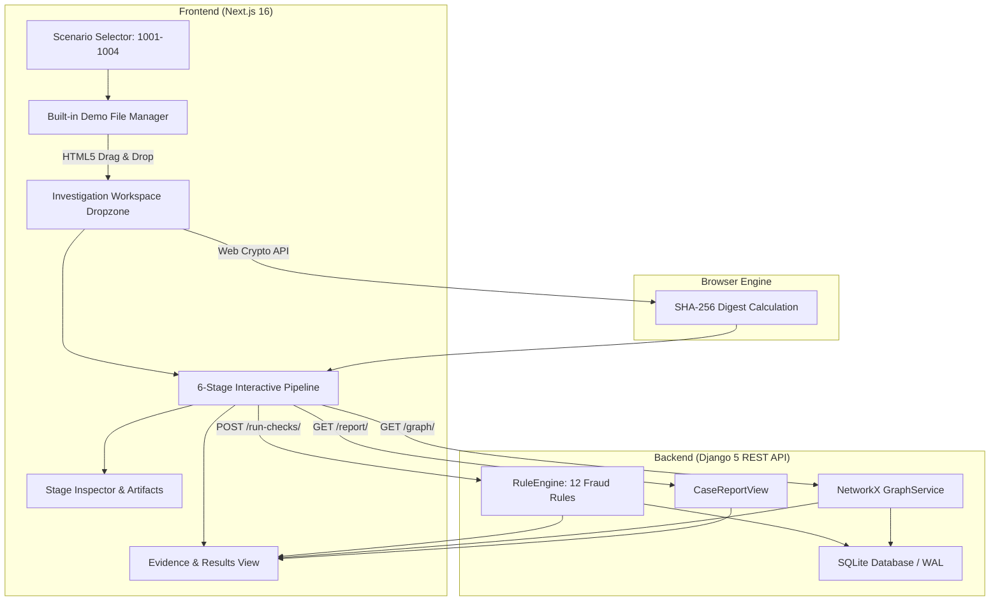

# UNBHUMI DETECTOR — INTERACTIVE DEMO ARCHITECTURE

**Document:** `docs/DEMO_ARCHITECTURE.md`  
**Target:** Hackathon Problem Statement P3 (Catch Fraud & Double-Selling)  
**System Architecture:** Hybrid Client-Server Deterministic Verification Engine

---

## 1. High-Level Architecture Overview

The UNBHUMI Detector Interactive Demo Mode (`/demo`) provides a self-contained, reproducible investigation environment for land document verification in Bangladesh.

---

## 2. Core Architectural Separation: Live vs Demo Mode

To ensure **strict architectural honesty**, the system maintains a clear operational boundary between Live Analysis and Demo Mode:

| Dimension | Live Analysis (`/documents/new`) | Demo Mode (`/demo`) |
|---|---|---|
| **Intended User** | Land Registry Reviewer / AC Land | Hackathon Evaluator, Auditor, Public Demo |
| **Document Input** | Citizen uploaded PDFs, scanned deed images | Deterministic synthetic land deed fixtures |
| **Cryptographic Hash** | Real SHA-256 computed on upload bytes | Real SHA-256 computed via Web Crypto API |
| **OCR & Extraction** | OCRService parsing uploaded file bytes | Authentic pre-computed bounding boxes & scores |
| **Rule Engine** | Live Django `RuleEngine` execution | Live Django `RuleEngine` execution |
| **Graph Construction**| Live NetworkX directed graph builder | Live NetworkX directed graph builder |
| **Persistence** | Persisted to DB with unique case ID | Persisted and isolated per scenario |
| **Ground Truth** | Unknown until examined by human reviewer | Deterministic expected fraud condition |

---

## 3. Data Flow & Stage Execution Pipeline

When the user triggers **"Run Verification Pipeline"** (`যাচাই পাইপলাইন চালু করুন`), the workspace executes 6 distinct stages in sequential order:

### Stage 1: Document Intake & Validation (`demo_s1_name`)
- Validates that files in the workspace have valid extensions (`.pdf`, `.png`, `.jpg`).
- Enforces safe internal file identifiers to prevent directory traversal attacks.
- Discloses provenance: *Executed live via client-side file intake & API validation boundary.*

### Stage 2: Cryptographic Fingerprint (`demo_s2_name`)
- Calculates actual 64-character SHA-256 hash using the browser's native `crypto.subtle.digest('SHA-256', arrayBuffer)`.
- Checks against the backend `DocumentFingerprint` database to detect duplicate files across cases.
- Discloses provenance: *Computed live via browser Web Crypto API and cross-checked against fingerprint DB.*

### Stage 3: OCR & Field Extraction (`demo_s3_name`)
- Parses legal deed headers, registration dates, party names (seller/buyer/owner), mouza, dag numbers, and area decimals.
- Associates field-level confidence ratings and visual bounding boxes (`{ x, y, w, h }`).
- Discloses provenance: *Deterministic synthetic OCR fixture with field-level confidence ratings.*

### Stage 4: Field Normalization (`demo_s4_name`)
- Converts Bengali numerals (`০, ১, ২, ৩, ৪, ৫, ৬, ৭, ৮, ৯`) to standard integers (`0-9`).
- Converts diverse date formats (`১৫/০৩/২০২৬`) into ISO standard (`2026-03-15`).
- Standardizes area units (শতক/শতাংশ to decimal acres).
- Discloses provenance: *Executed live via deterministic normalization functions.*

### Stage 5: Rule Engine Cross-Check (`demo_s5_name`)
- Calls backend API `POST /api/v1/cases/<id>/run-checks/`.
- Evaluates 12 rules across deed, khatian, and prior transfer records.
- Flags conflicts such as `P001` (Double-Selling), `K001` (Owner mismatch), and `O001` (Broken Chain).
- Discloses provenance: *Executed live via Django RuleEngine on SQLite persistence layer.*

### Stage 6: Graph & Risk Scoring (`demo_s6_name`)
- Calls backend API `GET /api/v1/cases/<id>/graph/`.
- Constructs a directed graph of parcels, khatians, mutations, deeds, and persons.
- Detects multiple outgoing transfers on the same parcel (double-selling paths).
- Computes calibrated composite risk score (0 to 100).
- Discloses provenance: *Constructed live via NetworkX GraphService & persisted in OwnershipEdge models.*

---

## 4. The 4 Synthetic Scenarios

1. **`UB-2026-1001` — Normal Ownership Transfer (Clean)**
   - *Mouza:* Kaundia | *Dag:* 412 | *Area:* 25.0 decimals
   - *Outcome:* Risk 0 / 100 (Low Risk, Verified Consistent).
   - *Verification:* Registered deed, RS khatian, mutation record, and land-tax dakhila all reconcile with zero contradictions.

2. **`UB-2026-1002` — Suspected Double-Selling (Critical Fraud Conflict)**
   - *Mouza:* Dhamrai | *Dag:* 88 | *Area:* 40.0 decimals
   - *Outcome:* Risk 85 / 100 (Critical Conflict).
   - *Conflict:* Seller Kamal Hossain executed deed 8910 in 2026 to Md. Jasim Uddin, after previously transferring the exact same parcel under deed 3201 in 2024 to Md. Rafiqul Islam.
   - *Detection:* Triggered rule `P001` and highlighted conflicting edge in ownership graph.

3. **`UB-2026-1003` — Baya Deed Ownership Chain Inconsistency (Broken Chain)**
   - *Mouza:* Tetuljhora | *Dag:* 291 | *Area:* 18.5 decimals
   - *Outcome:* Risk 65 / 100 (High Risk).
   - *Conflict:* Khatian record is registered to Late Golam Rahman, but current seller is Md. Saiful Islam. No baya deed or inheritance record exists in the package.
   - *Detection:* Triggered rules `K001` and `O001`.

4. **`UB-2026-1004` — Deed vs Khatian Mismatch (Unverified Seller)**
   - *Mouza:* Savar | *Dag:* 510 | *Area:* 30.0 decimals
   - *Outcome:* Risk 60 / 100 (High Risk).
   - *Conflict:* Proposed deed lists Anwar Hossain as seller, but official survey record lists Harendra Kumar Saha with no record of transfer.
   - *Detection:* Triggered rule `K001`.

---

## 5. How to Add Another Synthetic Case

To add a new synthetic case (e.g. `UB-2026-1009`):
1. **Backend Seed (`backend/services/seed_service.py`):**
   Add a scenario dictionary to `scenarios` list with `case_number`, `title`, `mouza`, `dag`, `area`, `seller`, `buyer`, `deed_no`, and `conflict_type`.
2. **Frontend Scenario Registry (`frontend/app/demo/page.tsx`):**
   Add a scenario object to `DEMO_SCENARIOS` with `id`, `titleBn`, `titleEn`, `mouza`, `dagNumber`, `expectedRiskLevel`, and sample document fixtures in `documents`.
3. **Run Seed Command:**
   Trigger `POST /api/v1/seed-demo/` or click "Reset Demo Data" in the UI.

---

## 6. How to Connect a Live AI Model or External Registry

When live credentials or heavy vision services become available:
1. **OCR Adapter:** Update `backend/services/ocr_service.py` to call Google Cloud Vision or Tesseract OCR in `process_document()`.
2. **Embedding / Vector Search:** Store extracted clauses in `pgvector` or ChromaDB to enable semantic cross-document retrieval.
3. **Government Registry:** Implement a REST client in `backend/services/government_gateway.py` with API token authorization to verify mutations against `land.gov.bd` or `eporcha.gov.bd`.
