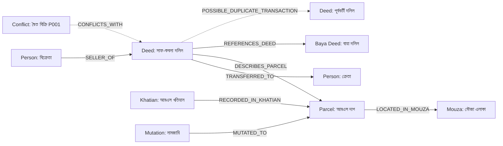

# UNBHUMI DETECTOR — EVIDENCE-GROUNDED KNOWLEDGE GRAPH & GRAPHRAG ARCHITECTURE
**Document Version:** 2.0.0  
**Target Module:** `/demo` (Tab 2: মালিকানা সম্পর্ক গ্রাফ) & `/ownership-graph` (Standalone Visualizer)  
**System Layer:** NetworkX MultiDiGraph Service + REST API (`/api/v1/cases/<case_id>/graph-rag/`) + SVG Vector Visualizer

---

## 1. Executive Summary & Objective

The **Ownership Knowledge Graph & GraphRAG Visualizer** (`মালিকানা সম্পর্ক গ্রাফ`) replaces static network diagrams with an evidence-grounded knowledge graph and genuine GraphRAG investigation tool. Built from the actual documentary evidence of land cases in Bangladesh, it enables investigators to:
1. Visualize land ownership transfer chains and parcel relationships.
2. Trace directional transactions from recorded owners to buyers through deeds and mutation records.
3. Visually isolate contradictory claims, double-selling attempts, and missing baya deed links.
4. Execute genuine GraphRAG queries with NetworkX subgraph traversal and grounded documentary citations.
5. Navigate with a single click from any graph node or relationship edge directly to the original document page preview.

---

## 2. Graph Topology & Schema

### Supported Node Types (8 Categories)
Every node is uniquely identified by a stable canonical ID and assigned a distinct visual category:

| Node Type | Category Color | Label Example | Description |
|:---|:---:|:---|:---|
| **`person`** | `#1E3A8A` (Deep Navy) | মো: আব্দুর রহিম | Recorded owner, buyer, seller, or heir |
| **`deed`** | `#15803D` (Emerald) | সাফ-কবলা দলিল নং ৮৯১০ | Registered deed or title transfer document |
| **`baya_deed`** | `#0D9488` (Teal) | বায়া দলিল নং ৩২০১ | Historical prior deed supporting the title chain |
| **`parcel`** | `#854D0E` (Amber) | আরএস দাগ নং ৮৮ | Land parcel / plot identified by survey dag |
| **`khatian`** | `#4338CA` (Indigo) | আরএস খতিয়ান নং ৪১২ | Official Record of Rights (CS/SA/RS/BS) |
| **`mutation`** | `#0369A1` (Sky Navy) | নামজারি খতিয়ান নং ১০৫২ | Mutation record / খারিজ approved by AC Land |
| **`mouza`** | `#475569` (Slate) | মৌজা: ধামরাই | Revenue village / administrative boundary |
| **`conflict`** | `#DC2626` (Crimson) | অসঙ্গতি P001 (দ্বৈত বিক্রি) | Detected anomaly or title inconsistency finding |

### Directed Relationship Edge Types (10 Categories)
Every edge represents an explicit, directed legal or physical relationship supported by documentary evidence:



- **`TRANSFERRED_TO`**: Property ownership transferred from deed/mutation to buyer.
- **`SELLER_OF`**: Recorded seller executing the conveyance deed.
- **`REFERENCES_DEED`**: Current deed referencing prior title deed (বায়া দলিল).
- **`RECORDED_IN_KHATIAN`**: Land parcel recorded under specific survey khatian.
- **`MUTATED_TO`**: Land parcel mutation approved under Upazila Land Office order.
- **`DESCRIBES_PARCEL`**: Deed schedule specifying dag, mouza, and transferred decimal area.
- **`LOCATED_IN_MOUZA`**: Parcel situated within specific revenue mouza and JL number.
- **`SUPPORTED_BY_DOCUMENT`**: Relationship directly evidenced by document ID and page number.
- **`CONFLICTS_WITH`**: Crimson dashed edge indicating title inconsistency or rule violation.
- **`POSSIBLE_DUPLICATE_TRANSACTION`**: Alert edge highlighting multiple sales of identical land.

---

## 3. Backend NetworkX GraphRAG Architecture

### Service Implementation (`backend/services/graph_service.py`)
The backend constructs a `networkx.MultiDiGraph` for each case dynamically from relational models (`Case`, `Document`, `DeedTransaction`, `KhatianRecord`, `MutationRecord`, `LandParcel`, `AnomalyFinding`):

```python
class GraphService:
    @classmethod
    def build_case_graph(cls, case_id: str) -> dict:
        # 1. Queries case models
        # 2. Instantiates nodes with canonical IDs
        # 3. Connects directed edges with doc_ids and page_refs
        # 4. Computes graph metrics (node count, edge count, conflict edges)
        # Returns structured GraphData dictionary

    @classmethod
    def query_graph(cls, case_id: str, query: str) -> dict:
        # 1. Matches query tokens against node labels, deeds, and dags
        # 2. Runs NetworkX subgraph traversal (ego_graph / 1-hop & 2-hop neighborhoods)
        # 3. Gathers grounded documentary evidence and confidence scores
        # 4. Generates bilingual forensic synthesis (Bangla & English)
        # Returns GraphRAGResult with retrieved_nodes, retrieved_edges, and grounded_evidence
```

### GraphRAG REST API Endpoint
- **URL:** `GET /api/v1/cases/<case_id>/graph-rag/?q=<query>`
- **Response Format:**
```json
{
  "retrieved_nodes": [
    {
      "id": "person_135",
      "label": "কামাল হোসেন",
      "type": "person",
      "subtext": "বিক্রেতা / সাবেক মালিক (Seller)",
      "doc_ids": [125],
      "page_refs": [1]
    }
  ],
  "retrieved_edges": [
    {
      "id": "e_deed_72_person_136",
      "source": "deed_72",
      "target": "person_136",
      "relation": "TRANSFERRED_TO",
      "label": "⚠️ দ্বৈত বিক্রির শিকার",
      "is_conflict": true,
      "conflict_reason": "একই দাগ একই বিক্রেতার দ্বারা একাধিক ভিন্ন ক্রেতার নামে হস্তান্তরের দাবি",
      "doc_ids": [125],
      "page_refs": [1, 2]
    }
  ],
  "grounded_evidence": [
    {
      "doc_id": 125,
      "doc_title": "মূল সাফ-কবলা দলিল (নং ৮৯১০)",
      "doc_type": "Registered Deed",
      "page": 1,
      "field_key": "seller_name",
      "field_label_bn": "বিক্রেতার নাম",
      "field_value": "কামাল হোসেন",
      "confidence": 0.96,
      "hash_snippet": "392828459e134312"
    }
  ],
  "graph_synthesis_bn": "গ্রাফ আরএজি কোয়েরি বিশ্লেষণে ৪টি সাংঘর্ষিক সম্পর্ক শনাক্ত হয়েছে...",
  "graph_synthesis_en": "GraphRAG retrieval identified 4 conflicting edge relationships in the ownership topology...",
  "conflicts_count": 4,
  "metrics": {
    "total_nodes_in_case": 10,
    "retrieved_node_count": 10,
    "retrieved_edge_count": 11,
    "cited_documents_count": 2
  },
  "provenance": "NetworkX DiGraph Subgraph Traversal & Verified Case Evidence Grounding"
}
```

---

## 4. Documentary Evidence Provenance & 1-Click Navigation

Every graph element maintains verifiable provenance:
- **`doc_ids`**: The exact document ID(s) containing the evidence.
- **`page_refs`**: The exact page number(s) within the document.
- **Interactive Details Drawer:** When a user clicks any node or edge, the drawer displays:
  - Entity category, label, and canonical ID.
  - Extracted properties (Transferred area, Sub-Registry Office, Survey Dag, Mouza).
  - List of supporting documents with page numbers.
  - Active findings and conflict explanations (e.g., Rule P001 Double Selling).
  - **1-Click Direct Document Preview Button (`সরাসরি মূল দলিল প্রিভিউ দেখুন`):** Instantly triggers the high-resolution modal preview showing the original deed or khatian record.

---

## 5. Visualizer Capabilities

The frontend visualizer (`frontend/components/OwnershipGraphVisualizer.tsx`) is built using a custom vector SVG canvas:

1. **Interactive Canvas:** Smooth Pan (mouse drag), Zoom (+, -, reset), and Force-Directed node repositioning.
2. **Search:** Real-time filter by person name, deed number, khatian number, or dag number.
3. **Multi-Level Category Filtering:** Quick toggle pills for `All`, `Person`, `Deed`, `Baya Deed`, `Parcel`, `Khatian`, `Mutation`, `Conflict Only`.
4. **Neighborhood Illumination:** Selecting a node dims unrelated graph elements and illuminates immediate 1-hop and 2-hop connected edges and neighbor nodes.
5. **Chain-of-Title Flow View:** An alternative view mode showing the chronological title transfer sequence:
   $$\text{Previous Deed (বায়া দলিল)} \longrightarrow \text{Recorded Seller} \longrightarrow \text{Deed Transfer} \longrightarrow \text{Buyer} \longrightarrow \text{Mutation Record}$$
6. **Conflict Inspection:** Discrepancies and double-selling attempts are highlighted as dashed crimson edges with warning markers, emphasizing evidence contradictions rather than personal accusations.
7. **GraphRAG Search Bar:** Embedded search with suggested query chips (`দ্বৈত বিক্রি অনুসন্ধান`, `বিক্রেতার স্বত্ব যাচাই`, `বায়া দলিলের ধারাবাহিকতা`, `দাগের মালিকানা রেকর্ড`) executing real NetworkX retrieval.
