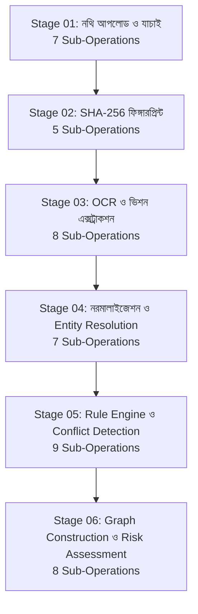

# UNBHUMI DETECTOR — ADVANCED PIPELINE OBSERVABILITY ARCHITECTURE
**Document Version:** 2.0.0  
**Target Module:** `/demo` — লাইভ পাইপলাইন মনিটর (Live Pipeline Monitor) & Execution Tracing  
**System Layer:** Full-Stack Observability (Django REST Backend + Next.js 16 Client + Web Crypto API)

---

## 1. Executive Summary & Objective

The **Live Pipeline Monitor** (`লাইভ পাইপলাইন মনিটর`) transforms the document verification process from a decorative animation into a deep, interactive execution monitor. Reviewers and judicial officers can inspect each document-analysis stage layer-by-layer, observe real execution timestamps and durations, verify intermediate artifacts, inspect cryptographic digests, review a 12-rule evaluation matrix, and trace provenance directly to original documentary evidence.

---

## 2. Six-Stage Multi-Layer Architecture

The monitor decomposes the verification process into six distinct stages, each containing 5 to 9 granular sub-operations (44 sub-operations in total).



### Stage 01 — নথি আপলোড ও যাচাই (Document Ingestion & Validation)
- **OP-01 (INGEST_RECEIVE):** Receive document payload via drag-and-drop or scenario picker.
- **OP-02 (VAL_MIME_MAGIC):** Inspect MIME type and magic byte signatures (PDF, TIFF, JPEG).
- **OP-03 (VAL_SIZE_LIMIT):** Check document size against configured threshold (25MB limit).
- **OP-04 (CHECK_DUPLICATE_FILES):** Identify duplicate filenames and byte-level duplicates.
- **OP-05 (ASSIGN_INTERNAL_DOC_ID):** Assign UUID/canonical document identifier (e.g., `DOC-UB-2026-1002-01`).
- **OP-06 (CLASSIFY_DOC_TYPE):** Classify document type (`deed`, `khatian`, `mutation`, `mouza_map`).
- **OP-07 (RECORD_DOC_METADATA):** Record file metadata, page count, and client ingestion timestamp.

### Stage 02 — ক্রিপ্টোগ্রাফিক ফিঙ্গারপ্রিন্ট (Cryptographic Fingerprinting)
- **OP-01 (READ_BINARY_STREAM):** Read raw byte array of each ingested file.
- **OP-02 (CALC_SHA256_DIGEST):** Compute 256-bit SHA-256 digest via native Web Crypto API (`crypto.subtle.digest`).
- **OP-03 (RECORD_AUDIT_TRAIL):** Commit hash digest to immutable execution session log.
- **OP-04 (COMPARE_REF_DIGEST):** Compare computed hash with reference enrolled digests in Land Registry database.
- **OP-05 (CHECK_INTRA_CASE_DUPS):** Verify whether duplicate hashes exist within the current case files.

> [!WARNING]
> **আইনি স্বত্বাধিকার ও ক্রিপ্টোগ্রাফিক অখণ্ডতার সীমাবদ্ধতা (Statutory Non-Authenticity Caveat):**  
> ক্রিপ্টোগ্রাফিক হ্যাশ (SHA-256) ফাইলের বাইট-অখণ্ডতা এবং টেম্পারিং-প্রতিরোধ নিশ্চিত করে, কিন্তু বাংলাদেশ রেজিস্ট্রেশন আইন ১৯০৮ বা ভূমি সংস্কার আইন অনুযায়ী দলিলের আইনি স্বত্বাধিকার বা মূল স্বত্বের বৈধতা প্রমাণ করে না। আইনি স্বত্বাধিকার প্রমাণের জন্য সাব-রেজিস্ট্রি কার্যালয়ের মূল বালাম বহি ও সূচি বহির সাথে রেকর্ডীয় মিল আবশ্যক।

### Stage 03 — ওসিআর ও ভিশন এক্সট্রাকশন (OCR & Vision Extraction)
- **OP-01 (PREPARE_RASTER):** Rasterize document pages into 300 DPI high-contrast bitmaps.
- **OP-02 (PAGE_SEGMENTATION):** Segment document into structural regions (header, schedule of land, seal, signatures).
- **OP-03 (DISPATCH_OCR_ENGINE):** Execute Bangla/English OCR extractor (Tesseract OCR / Vision Model).
- **OP-04 (EXTRACT_BILINGUAL_TEXT):** Extract raw unicode text preserving Bengali and English numerals.
- **OP-05 (KEY_FIELD_EXTRACTION):** Extract targeted land fields (দলিল নং, দাগ নং, খতিয়ান নং, মৌজা, হস্তান্তরকৃত জমি, ক্রেতা/বিক্রেতার নাম).
- **OP-06 (EXTRACT_SPATIAL_TABLES):** Extract tabular boundaries (চৌহদ্দি/Four Boundaries: উত্তর, দক্ষিণ, পূর্ব, পশ্চিম).
- **OP-07 (ASSOCIATE_PAGE_REFS):** Map every extracted token to its specific source page number.
- **OP-08 (RECORD_FIELD_CONFIDENCE):** Calculate field-level confidence scores (e.g., 0.95 - 0.98).

> [!NOTE]
> **সিন্থেটিক ফিক্সচার প্রকাশ (Demo Fixture Disclosure):**  
> ডেমো মোডে প্রিকম্পিউটেড টেস্ট কেস নির্বাহের সময় ইন্টারফেসে সুস্পষ্টভাবে `DEMO FIXTURE` / `সিন্থেটিক ফিক্সচার (Precomputed Model Output)` ব্যাজ প্রদর্শিত হয়, যাতে বিচারক বা পরীক্ষক লাইভ এপিআই মডেল কলের সাথে ফিক্সচারের পার্থক্য সহজেই বুঝতে পারেন।

### Stage 04 — নরমালাইজেশন ও Entity Resolution
- **OP-01 (NORM_NUMERALS):** Normalize Bengali numerals (০-৯) to standardized Arabic digits (0-9) for mathematical comparisons while preserving Bengali display.
- **OP-02 (NORM_WHITESPACE_TEXT):** Strip zero-width joiners, normalize Unicode Bengali diacritics, and trim whitespace.
- **OP-03 (NORM_DATES_CALENDAR):** Convert Bengali Sambat/Bangabda dates and Gregorian dates to ISO 8601 (`YYYY-MM-DD`).
- **OP-04 (NORM_LAND_UNITS):** Standardize land units (শতাংশ, কাঠা, বিঘা, একর, ছটাক) into standardized decimal acres and decimals (শতক).
- **OP-05 (NORM_ADMIN_IDENTIFIERS):** Standardize District, Upazila, and Mouza JL numbers with Bangladesh National Geo-Code standards.
- **OP-06 (RESOLVE_CANDIDATE_ENTITIES):** Cluster candidate person names and parcel references supported by documentary evidence.
- **OP-07 (PRESERVE_RAW_IMMUTABILITY):** Keep raw un-normalized values alongside normalized values for forensic auditing.

> [!IMPORTANT]
> **জিরো সাইলেন্ট মার্জ পলিসি (Zero Silent Merging Policy):**  
> কেবল নাম বা বানানের সাদৃশ্যের ভিত্তিতে ব্যক্তি বা দাগের সত্তা কখনোই স্বয়ংক্রিয়ভাবে মার্জ/একত্রিত করা হয় না। পর্যাপ্ত দলিলভিত্তিক বা রেকর্ডীয় প্রমাণ ছাড়া সত্তা মার্জ করলে মিথ্যা পজিটিভ বা মিথ্যা ক্লিয়ারেন্স সৃষ্টি হতে পারে।

### Stage 05 — Rule Engine ও Conflict Detection
- **OP-01 (LOAD_RULESET_V2):** Load Rule Engine v2.4 (Bangladesh Land Fraud & Title Inconsistency Detection Rules).
- **OP-02 (EVAL_R01_SELLER_OWNER):** Rule R-01: Verify seller identity against latest Record of Rights (খতিয়ানভুক্ত মালিক).
- **OP-03 (EVAL_R02_DOUBLE_SALE):** Rule R-02: Check for prior registered transactions transferring the same plot from the same seller (দ্বৈত বিক্রি শনাক্তকরণ).
- **OP-04 (EVAL_R03_BAYA_CHAIN):** Rule R-03: Validate chronological continuity of prior deeds (বায়া দলিলের ধারাবাহিকতা).
- **OP-05 (EVAL_R04_AREA_EXCESS):** Rule R-04: Compare transferred deed area against recorded khatian entitlement.
- **OP-06 (EVAL_R05_DAG_MISMATCH):** Rule R-05: Check deed schedule dag against khatian dag and mouza map boundaries.
- **OP-07 (EVAL_R06_MUTATION_ALIGN):** Rule R-06: Verify mutation khatian registration against Upazila Land Office records.
- **OP-08 (EVAL_R07_R12_EXTENDED):** Evaluate remaining extended rules (R-07 to R-12).
- **OP-09 (AGGREGATE_SEVERITY):** Aggregate findings into risk penalty score (0–100 scale).

#### Complete 12-Rule Truthful Evaluation Matrix
For every case execution, all 12 rules are explicitly recorded. Non-applicable rules are never silently suppressed:

| Rule Code | Description | Status | Evidence / Reason |
|:---|:---|:---:|:---|
| **R-01** | বিক্রেতার স্বত্ব বনাম খতিয়ান মালিকানা যাচাই | PASS / FAIL | মূল দলিলের বিক্রেতা বনাম সিএস/এসএ/আরএস খতিয়ান প্রজা |
| **R-02** | দাগের পূর্ববর্তী লেনদেন ও দ্বৈত বিক্রি শনাক্তকরণ | PASS / FAIL | একই দাগে একই বিক্রেতা কর্তৃক একাধিক সাফ-কবলা হস্তান্তর |
| **R-03** | বায়া দলিলের ঐতিহাসিক ধারাবাহিকতা অক্ষুণ্ণতা | PASS / FAIL | পূর্ববর্তী হস্তান্তরের বৈধ বালাম বা দলিলের রেফারেন্স |
| **R-04** | রেকর্ডীয় হিস্যার অতিরিক্ত জমি বিক্রির দাবি যাচাই | PASS / FAIL | খতিয়ানভুক্ত প্রাপ্য শতক বনাম দলিলে উল্লেখিত শতক |
| **R-05** | মৌজা ও আরএস দাগ নম্বর সামঞ্জস্যতা | PASS / FAIL | দলিল তফসিল বনাম আরএস খতিয়ানের দাগ ও মৌজা |
| **R-06** | নামজারি খতিয়ান ও জমাভাগ অনুমোদন মিল | PASS / FAIL | এসি ল্যান্ড কার্যালয়ের খারিজ কেস ও নামজারি খতিয়ান |
| **R-07** | মূল ফাইলের সাথে হ্যাশ বৈসাদৃশ্য ও টেম্পারিং | PASS / FAIL | ক্রিপ্টোগ্রাফিক SHA-256 রেফারেন্স অখণ্ডতা |
| **R-08** | মৌজা ম্যাপ চতুঃসীমানা ও ভৌগোলিক দাগ সংঘাত | PASS / FAIL | তফসিলে উল্লেখিত উত্তর/দক্ষিণ/পূর্ব/পশ্চিম সীমানা |
| **R-09** | ওসিআর অপাঠ্য বা ঝাপসা হাতের লেখা সতর্কতা | PASS / FAIL | হস্তলিখিত অংশের কনফিডেন্স স্কোর থ্রেশহোল্ড (<0.60) |
| **R-10** | অর্পিত / পরিত্যক্ত সম্পত্তি গেজেট যাচাই | `NOT APPLICABLE` | বর্তমান তফসিলে কোনো ক/খ তালিকাভুক্ত অর্পিত সম্পত্তি দাবি নেই |
| **R-11** | নদীভাঙন ও সিকস্তি-পয়স্তি আইনের প্রয়োগ | `NOT APPLICABLE` | সংশ্লিষ্ট মৌজা নদী সংলগ্ন বা সিকস্তি ঘোষিত এলাকা নয় |
| **R-12** | আদালত নিষেধাজ্ঞা ও দেওয়ানি মামলা সতর্কতা | `NOT APPLICABLE` | কোনো সক্রিয় আদালতের নিষেধাজ্ঞা বা ডিক্রি রেকর্ডভুক্ত নয় |

### Stage 06 — Graph Construction ও Risk Assessment
- **OP-01 (CONSTRUCT_GRAPH_NODES):** Instantiate entity nodes (`person`, `deed`, `baya_deed`, `parcel`, `khatian`, `mutation`, `mouza`, `conflict`).
- **OP-02 (BUILD_DIRECTED_EDGES):** Create directed edges with explicit relationship semantics.
- **OP-03 (ATTACH_EVIDENCE_PROVENANCE):** Attach document IDs (`doc_ids`) and page numbers (`page_refs`) to every node and edge.
- **OP-04 (DETECT_CYCLIC_TRANSFERS):** Run topological cycle detection to identify conflicting circular transactions.
- **OP-05 (EXECUTE_GRAPHRAG_QUERY):** Query graph topology with NetworkX subgraph traversal and retrieve grounded evidence passages.
- **OP-06 (GROUND_EVIDENCE_CITATIONS):** Extract verified field citations and hash snippets for every finding.
- **OP-07 (COMPUTE_FINAL_RISK_SCORE):** Calculate composite risk score (0-100) and risk tier (`CLEAN`, `REVIEW`, `HIGH`, `CRITICAL`).
- **OP-08 (GENERATE_AUDIT_REPORT):** Produce final verification report and forensic audit summary.

---

## 3. Structured Pipeline Event Model

Every stage and sub-operation produces a structured `PipelineExecutionEvent` complying with the following schema:

```typescript
export interface PipelineExecutionEvent {
  event_id: string;          // Unique UUID for the execution event
  run_id: string;            // Pipeline run identifier (e.g., RUN-20261018-024012)
  case_id: string;           // Target case ID (e.g., UB-2026-1002)
  document_id?: string;      // Related document ID if document-specific
  stage_id: number;          // Stage index (1 to 6)
  operation_id: string;      // Sub-operation code (e.g., OP-02)
  operation_name: string;    // Human-readable title
  status: 'PENDING' | 'RUNNING' | 'COMPLETED' | 'WARNING' | 'FAILED' | 'SKIPPED';
  started_at: string;        // ISO 8601 start timestamp
  completed_at?: string;     // ISO 8601 end timestamp
  duration_ms: number;       // Elapsed execution time in milliseconds
  input_summary: string;     // Summary of inputs processed
  output_summary: string;    // Summary of outputs produced
  artifact_refs: string[];   // Pointers to intermediate artifacts
  warnings: string[];        // Non-fatal warnings encountered
  error?: string;            // Fatal error details if failed
  provenance: string;        // Component or engine generating the event
}
```

---

## 4. Intermediate Artifacts Inspector

Below the sub-operations execution trace, the **ইন্টারমিডিয়েট আর্টিফ্যাক্টস পরিদর্শক** (Intermediate Artifacts Inspector) exposes 8 dedicated tabs allowing reviewers to inspect raw and structured intermediate outputs:

1. **নথি মেটাডাটা (Metadata):** Document IDs, filenames, sizes, MIME types, categories, page counts, and validation checks.
2. **ক্রিপ্টোগ্রাফিক হ্যাশ (Hashes):** Full 64-character SHA-256 digests, calculation status, reference comparison results, statutory non-authenticity legal disclaimer banner, and a 1-click **কপি (Copy)** button.
3. **ওসিআর ও ভিশন (OCR & Fields):** Engine info, page segmentation preview, extracted Bengali text, field confidence scores, and explicit `DEMO FIXTURE` / `সিন্থেটিক ফিক্সচার` tag.
4. **নরমালাইজেশন (Normalization):** Raw input vs normalized value side-by-side comparison, conversion rules, and the Zero Silent Merging policy notice.
5. **রুল ইঞ্জিন ম্যাট্রিক্স (Rule Matrix):** 12-rule matrix showing Rule ID, description, evaluation result (`PASS`, `FAIL`, `NOT APPLICABLE`), expected vs observed values, severity, and risk contribution.
6. **নলেজ গ্রাফ (Graph):** Node count, edge count, conflict count, entity types, relationship types, and NetworkX engine status.
7. **ঝুঁকি স্কোরিং (Risk Breakdown):** Penalty point breakdown, weighted categories (deed mismatch, missing chain, double selling), and final recommendation.
8. **JSON ইভেন্ট লগ (Events Log):** Raw structured JSON array of all `PipelineExecutionEvent` records for system auditability.

---

## 5. Truthful Error Handling & Fallback Policy

- **No Silent Failures:** If an operation fails, the stage is marked `FAILED` with the exact error message.
- **Downstream Protection:** Dependent downstream stages remain in `PENDING` state and are never falsely shown as completed.
- **Fixture Transparency:** Synthetic fixture outputs are always explicitly badged as `DEMO FIXTURE` / `সিন্থেটিক ফিক্সচার (Precomputed Model Output)` rather than falsely claiming live AI model execution.
- **State Isolation:** Switching cases cleanly purges all prior run events and intermediate artifacts, preventing state leakage.
